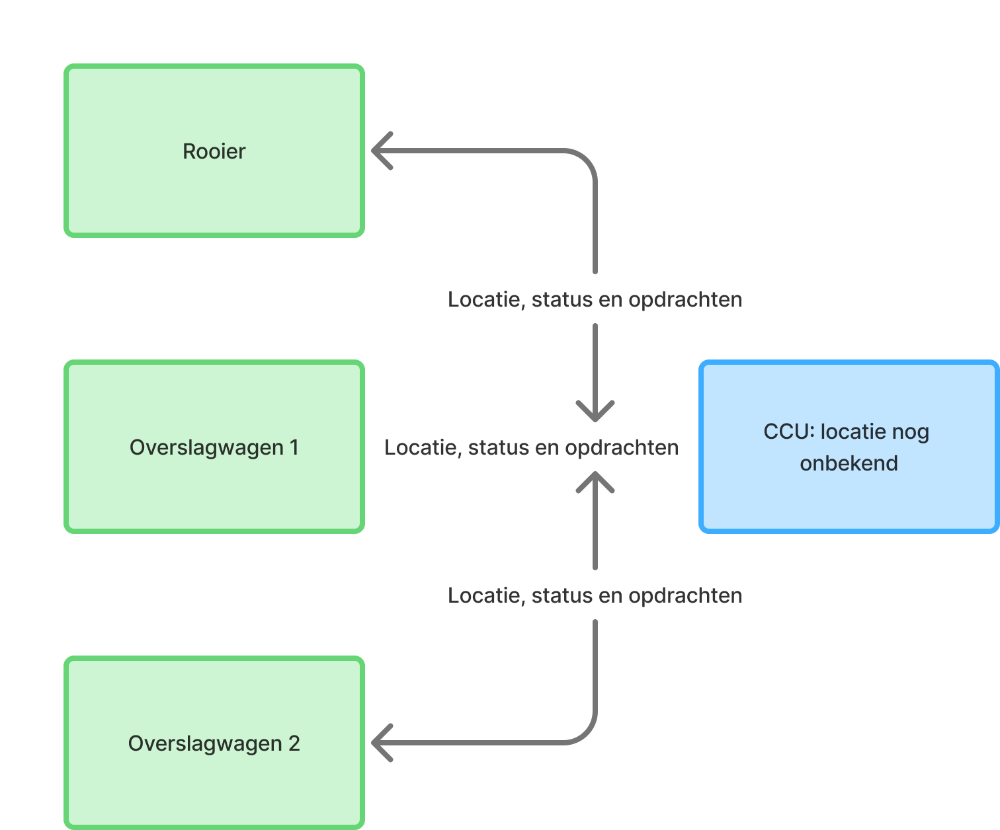

#Probleemanalyse
##Probleembeschrijving
Binnen ons robotvlootproject wordt gewerkt aan een systeem bestaande uit één rooier en twee overslagwagens. Deze machines moeten met elkaar samenwerken om het oogstproces zo efficiënt mogelijk te laten verlopen.

Uit ons vooronderzoek is gebleken dat een gecentraliseerde besturingsarchitectuur mogelijk geschikt is voor deze robotvloot. Hierbij wordt gebruikgemaakt van een centrale controlunit (CCU), die gegevens van de robots ontvangt, verwerkt en vervolgens opdrachten terugstuurt.

Om deze architectuur goed te laten functioneren, is betrouwbare communicatie tussen de robots en de CCU van belang.

Tijdens het oogstproces verplaatsen de robots zich voortdurend over het landbouwperceel. Hierdoor veranderen de afstanden en mogelijke obstakels tussen de robots en de draadloze infrastructuur. Dit kan invloed hebben op de kwaliteit en betrouwbaarheid van de communicatie.

Momenteel is nog niet duidelijk in hoeverre de plaatsing van de draadloze infrastructuur invloed heeft op deze betrouwbaarheid. Hierdoor ontbreekt een onderbouwing voor het bepalen van een geschikte locatie voor de communicatie-infrastructuur.

[Dit diagram laat zien hoe de rooier en twee overslagwagens communiceren met de centrale controlunit (CCU).]

##Belang
Een betrouwbare communicatie tussen de robots en de CCU is belangrijk om het oogstprocess effecient en veilig te laten verlopen. De plaatsing van de draadloze infrastructuur kan hierbij een belangrijke rol spelen.

Wanneer de infrastructuur ongunstig word geplaatst wordt geplaats, kan dit gevolgen hebben voor de signaalkwaliteit, hogere latency en packet loss. hierdoor kunnen gegevens en opdrachten vertraagd worden of helemaal niet op de bedoelde bestemming aankomen.

Dit kan gevolgen hebben voor de effecientie van het oogstprocess. Wanneer een overslagwagen bijvoorbeeld niet op tijd wordt aangestuurd, kan de rooier moeten wachten. Daarnaast kunnen vertragingen in de communicatie de gezamenlijke routeplanning verstoren, waardoor de overslagwagens mogelijk onnodige afstanden afleggen en extra bodemverdichting veroorzaken.

Door te onderzoeken welke invloed de plaatsing van de draadloze infrastructuur heeft op de betrouwbaarheid van de communicatie, kunnen we een onderbouwde keuze maken voor een geschikte opstelling binnen onze robotvloot.

##Wat is al bekend

##Doelstelling
Het doel van dit onderzoek is om inzicht te krijgen in de invloed van de plaatsing van de draadloze infrastructuur op de betrouwbaarheid van de communicatie binnen onze robotvloot.

Door middel van literatuuronderzoek en praktische metingen willen we onderzoeken welke factoren invloed hebben op de communicatiebetrouwbaarheid. Hierbij kijken we onder andere naar latency, packet loss en signaalkwaliteit.

Met behulp van een Proof of Concept (PoC) willen we verschillende plaatsingen van de draadloze infrastructuur onder vergelijkbare omstandigheden testen.

Op basis van de verzamelde resultaten willen we een onderbouwd advies geven over een geschikte plaatsing van de draadloze infrastructuur binnen onze robotvloot.

