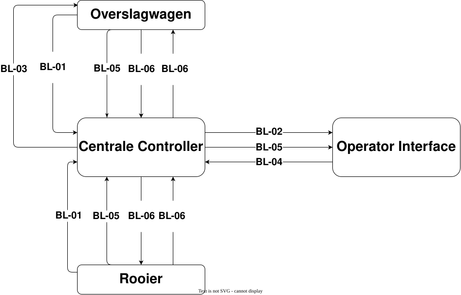

De keuze tussen TCP en UDP wordt gebaseerd op de eigenschappen van beide transportprotocollen. Verschillende bronnen [1][2][3][4] beschrijven de verschillen tussen deze protocollen. Voor dit onderzoek worden voornamelijk de headergrootte en de betrouwbaarheid van de gegevensoverdracht meegenomen in de afweging.

UDP heeft een kleinere header en daardoor minder protocoloverhead dan TCP. TCP biedt daarentegen betrouwbare en geordende gegevensoverdracht, maar brengt hiervoor extra overhead met zich mee.

De keuze tussen beide protocollen wordt gemaakt op basis van de communicatiebehoeften van de betreffende berichtlijn. Hierbij wordt gekeken naar de gevolgen van verloren berichten en de invloed van protocoloverhead. Wanneer het beperken van overhead belangrijker is dan het opnieuw afleveren van een bericht, wordt UDP overwogen. Wanneer betrouwbare gegevensoverdracht belangrijker is, wordt TCP gekozen.

De gevolgen van berichtverlies worden beoordeeld aan de hand van de mogelijke kans en impact van het missen van een bericht.

# Multi-communicatiemethode

Hier is de keuze gefocust op wat de beste optie is voor alle aparte berichtlijnen.
| ID | Berichtlijn | Doel van de communicatie |
| --- | --- | --- |
| BL-01 | Systeem positiecommunicatie | De centrale controller informeren over de locatie van de machines |
| BL-02 | Interface positiecommunicatie | De operator informeren over de locatie van de machines |
| BL-03 | Controller besturingscommunicatie | De overslagwagens aansturen op basis van hun positie en de positie van de rooier |
| BL-04 | Operator besturingscommunicatie | De operator de snelheid te kunnen laten aanpassen wanneer een rooier naast hen staat |
| BL-05 | Statuscommunicatie | De centrale controller en operator informeren over de actuele status van de machines |
| BL-06 | Overlaadcommunicatie | Het informeren over overlaadstatus |
*Een versimpelt overzicht van de verschillende berichtlijnen en hun communicatiedoel

## BL-01 Systeem positiecommunicatie

*   **Doel:** De centrale controller informeren over de locatie van de machines
*   **Verzender:** Rooier en overslagwagens
*   **Ontvanger:** Centrale controller
*   **Inhoud van berichten:**

| Variabele | Datatype | Eenheid of structuur |
| --- | --- | --- |
| machine_id | GUID |  |
| timestamp | String | ISO 8601 of `YYYY-MM-DD hh:mm:ss` |
| latitude | Double | Graden (°) |
| longitude | Double | Graden (°) |
| direction | Double | Richtingshoek in graden (0–360°) |
| speed | Double | km/u |
*   **Manier van versturen:** Periodiek

### Gekozen protocol

**UDP = Overhead > Betrouwbaarheid**  
Deze berichtlijn verstuurt periodiek locatie-updates. Wanneer een update verloren gaat, wordt korte tijd later een nieuwe locatie-update verstuurd. Hierdoor is het niet noodzakelijk dat ieder afzonderlijk bericht aankomt, zolang het systeem kan vaststellen wanneer de laatst ontvangen update heeft plaatsgevonden.

UDP is hiervoor geschikt, omdat het minder protocoloverhead heeft dan TCP. Hierdoor kan de hoeveelheid extra verzonden data worden beperkt. De lagere betrouwbaarheid van UDP is bij deze berichtlijn acceptabel, omdat nieuwe updates eerdere locatie gegevens vervangen.

## BL-02 Interface positiecommunicatie

*   **Doel:** De Operatorinterface informeren over de locatie van de machines
*   **Verzender:** Centrale controller
*   **Ontvanger:** Operatorinterface
*   **Inhoud van berichten:**

| Variabele | Datatype | Eenheid of structuur |
| --- | --- | --- |
| machine_id | GUID |  |
| timestamp | String | ISO 8601 of `YYYY-MM-DD hh:mm:ss` |
| latitude | Double | Graden (°) |
| longitude | Double | Graden (°) |
| direction | Double | Richtingshoek in graden (0–360°) |
| speed | Double | km/u |
*   **Manier van versturen:** Periodiek

### Gekozen protocol

**UDP = Overhead > Betrouwbaarheid**  
Deze berichtlijn verstuurt periodiek locatie-updates. Wanneer een update verloren gaat, wordt korte tijd later een nieuwe locatie-update verstuurd. Hierdoor is het niet noodzakelijk dat ieder afzonderlijk bericht aankomt, zolang het systeem kan vaststellen wanneer de laatst ontvangen update heeft plaatsgevonden.

UDP is hiervoor geschikt, omdat het minder protocoloverhead heeft dan TCP. Hierdoor kan de hoeveelheid extra verzonden data worden beperkt. De lagere betrouwbaarheid van UDP is bij deze berichtlijn acceptabel, omdat nieuwe updates eerdere locatie gegevens vervangen.

## BL-03 Controller besturingscommunicatie

*   **Doel:** De overslagwagens aansturen op basis van hun positie en de positie van de rooier
*   **Verzender:** Centrale controller
*   **Ontvanger:** Overslagwagens
*   **Inhoud van berichten:**

| Variabele | Datatype | Eenheid of structuur |
| --- | --- | --- |
| machine_id | GUID |  |
| timestamp | String | ISO 8601 of `YYYY-MM-DD hh:mm:ss` |
| direction | Enum uint8 | `NORTH`, `WEST`, `SOUTH`, `EAST` |
| unloading_action | Enum uint8 | `START`, `STOP`, `IDLE`, `STOPPED` |
*   **Manier van versturen:** Gebeurtenis gestuurd - Wanneer op specifieke punten op de akker

### Gekozen protocol:

**TCP = Overhead < Betrouwbaarheid**  
Deze berichtlijn bevat besturingscommando's voor de overslagwagens. Wanneer een commando verloren gaat, kan de overslagwagen mogelijk niet de gewenste actie uitvoeren. Bij een `direction`-commando kan dit bijvoorbeeld betekenen dat de wagen niet de gewenste richting op rijdt. Bij een `unloading_action`-commando kan het overladen mogelijk niet op het juiste moment starten of stoppen.

Omdat deze berichten belangrijke besturingsinformatie bevatten, is betrouwbare gegevensoverdracht belangrijker dan het beperken van protocoloverhead. Daarom wordt gekozen voor TCP.

## BL-04 Operator besturingscommunicatie

*   **Doel:** De operator de snelheid te kunnen laten aanpassen wanneer een rooier naast hen staat
*   **Verzender:** Operatorinterface
*   **Ontvanger:** Overslagwagen
*   **Inhoud van berichten:**

| Variabele | Datatype | Eenheid of structuur |
| --- | --- | --- |
| machine_id | GUID |  |
| timestamp | String | ISO 8601 of `YYYY-MM-DD hh:mm:ss` |
| control_mode | Enum uint8 | `Linear_Manual`,`Angular_Manual`,`Automatic` |
| linear_speed | Double | km/u |
| angular_speed | Double | km/u |
*   **Manier van versturen:** Gebeurtenis gestuurd - Tijdens handmatige besturing via de afstandsbediening.
  
*Dit kan nog verder worden opgesplitst naar zijkant operator en bestuurder operator maar omdat hoe erg het op elkaar lijkt is het voor dit onderzoek hetzelfde

### Gekozen protocol:

**TCP = Overhead < Betrouwbaarheid**  
Deze berichtlijn bevat besturingscommando's waarmee de operator de snelheid en beweging van de overslagwagen kan aanpassen. Wanneer een bericht verloren gaat, kan de overslagwagen mogelijk niet de gewenste actie uitvoeren. Dit kan er bijvoorbeeld toe leiden dat de wagen te snel of te langzaam rijdt, of op de verkeerde plek terechtkomt. Dit kan uiteindelijk leiden tot product verlies.

Omdat deze berichten belangrijk zijn voor het besturen van de overslagwagen, is betrouwbaarheid belangrijker dan het beperken van de protocoloverhead. Daarom wordt gekozen voor TCP.

## BL-05 Statuscommunicatie

*   **Doel:** De centrale controller en operator informeren over de actuele status van de machines
*   Verzender 1: Rooier en overslagwagens
*   Ontvanger 1 / Verzender 2: Centrale controller
*   Ontvanger 2: Operator interface
*   **Inhoud van berichten:**

| Variabele | Datatype | Eenheid of structuur |
| --- | --- | --- |
| machine_id | GUID |  |
| timestamp | String | ISO 8601 of `YYYY-MM-DD hh:mm:ss` |
| task_status | Enum uint8 | `DRIVING`, `UNLOADING`, `IDLE` |
| control_status | Enum uint8 | `AUTOMATIC`, `MANUAL` |
| linear_speed | Double | km/u |
| angular_speed | Double | km/u |
| fault_code | Enum unit8 |  |

*   **Manier van versturen:** Gebeurtenis gestuurd - Wanneer de status van een machine verandert

*De berichtlijn gaat als volgt Rooier/Overslagwagen -> centrale controller -> operator interface

### Gekozen protocol:

**TCP = Overhead < Betrouwbaarheid**  
Deze berichtlijn verstuurt belangrijke informatie over de status van de machines, zoals statusveranderingen en foutcodes. Wanneer een bericht verloren gaat, kan het gebeuren dat de centrale controller of operator niet op de hoogte is van een probleem of verandering bij een machine. Hierdoor kan het langer duren voordat er op een probleem wordt gereageerd.

Omdat deze informatie belangrijk is om te weten wat er bij de machines gebeurt, is het belangrijk dat berichten betrouwbaar worden overgedragen. Daarnaast worden de berichten alleen verstuurd wanneer er iets verandert aan de status van een machine. Hierdoor blijft het aantal berichten beperkt en is de extra overhead van TCP geen groot probleem. Daarom wordt gekozen voor TCP.

## BL-06 Overlaadcommunicatie

*   **Doel:** Het informeren over overlaadstatus
*   Verzender 1: Rooier en overslagwagen
*   Ontvanger 1 / Verzender 2: Centrale controller
*   Ontvanger 2: Overslagwagen en rooier
*   **Inhoud van berichten:**

| Variabele | Datatype | Eenheid of structuur |
| --- | --- | --- |
| machine_id | GUID |  |
| timestamp | String | ISO 8601 of `YYYY-MM-DD hh:mm:ss` |
| unloading_command | Enum uint8 | `START` `STOP` |
*   **Manier van versturen:**
    1.  Gebeurtenis gestuurd - Wanneer de rooier begint met het vullen van de rooier
    2.  Gebeurtenis gestuurd - Wanner de rooier stopt met het vullen van de rooier  

*De berichtlijn gaat als volgt Rooier/Overslagwagen -> centrale controller -> Overslagwagen/Rooier

### Gekozen protocol:

**TCP = Overhead < Betrouwbaarheid**  
Deze berichtlijn bevat belangrijke commando's voor het starten en stoppen van het overladen. Wanneer een `START`-commando verloren gaat, kan het overladen mogelijk niet beginnen. Wanneer een `STOP`-commando verloren gaat, kan het overladen juist doorgaan terwijl dit niet meer de bedoeling is. Dit kan uiteindelijk leiden tot problemen tijdens het overladen of product verlies.

Omdat deze commando's belangrijk zijn voor het goed verlopen van het overlaadproces, is betrouwbaarheid belangrijker dan het beperken van de protocoloverhead. Daarom wordt gekozen voor TCP.

# Single-communicatiemethode

Bij de single-communicatiemethode wordt onderzocht welk transportprotocol de beste keuze is wanneer alle berichtlijnen gebruikmaken van hetzelfde protocol.

## Gekozen protocol:

**TCP = Overhead < Betrouwbaarheid**  
Meeste berichtlijnen die zijn genoemd hebben bij individuele evaluatie belang bij het gebruik van TCP de enige onderdelen die dit niet hebben zijn de berichtlijnen die periodiek iets moeten versturen. Het laten weten waar alles is heeft een lagere prioriteit dan controle hebben over de voertuigen, dus dit samen verklaart de keuze voor TCP.

# Gekozen protocollen

| ID | Berichtlijn | Multi-Protocol | Single-Protocol |
| --- | --- | --- | --- |
| BL-01 | Systeem positiecommunicatie | UDP | TCP |
| BL-02 | Interface positiecommunicatie | UDP | TCP |
| BL-03 | Controller besturingscommunicatie | TCP | TCP |
| BL-04 | Operator besturingscommunicatie | TCP | TCP |
| BL-05 | Statuscommunicatie | TCP | TCP |
| BL-06 | Overlaadcommunicatie | TCP | TCP |

* * *

# Bronnen

[1] “IP Stack - ICT-B ESE2.1 Robot Fleet 2026-27 P1-P2 Breda.” [https://brightspace.avans.nl/d2l/le/lessons/308932/topics/2074676](https://brightspace.avans.nl/d2l/le/lessons/308932/topics/2074676)  
[2] GeeksforGeeks, “TCP vs. UDP,” _GeeksforGeeks_, Mar. 28, 2026. [https://www.geeksforgeeks.org/computer-networks/differences-between-tcp-and-udp/](https://www.geeksforgeeks.org/computer-networks/differences-between-tcp-and-udp/)  
[3] I. Ivanov and I. Ivanov, “TCP and UDP essentials,” _NetworkAcademy.IO_. [https://www.networkacademy.io/ccna/network-security/tcp-and-udp-essentials](https://www.networkacademy.io/ccna/network-security/tcp-and-udp-essentials)  
[4] Josh and Josh, “TCP vs UDP: Header Size, Packet Size, and Differences,” _Digilent Blog_, Dec. 28, 2024. [https://digilent.com/blog/udp-vs-tcp/?srsltid=AYCX9vLJcLpOp7jxjgT7BCztAnE3uTWYkETFjQTNUACWdTd99XQXA3Zf](https://digilent.com/blog/udp-vs-tcp/?srsltid=AYCX9vLJcLpOp7jxjgT7BCztAnE3uTWYkETFjQTNUACWdTd99XQXA3Zf)