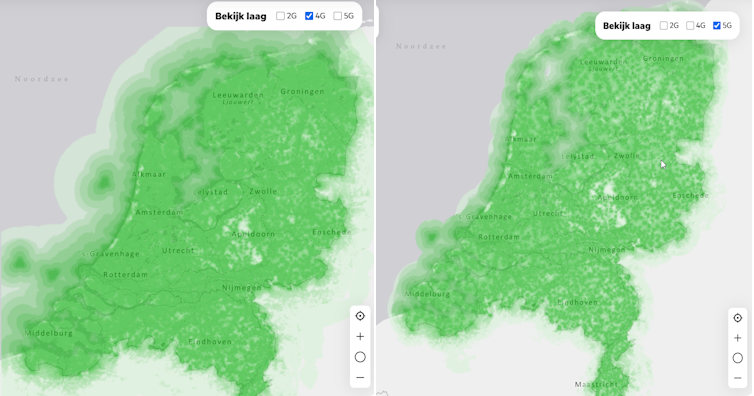

# 1. Casus probleemcontext
Het doel van het project is om bodemverdichting op landbouwakkers te verminderen door middel van robotisering. Hiervoor wordt een autonome robotvloot ontwikkeld die het oogstproces zo efficiënt mogelijk moet uitvoeren. Hieronder zie je de rollen van de voertuigen en operators.

## De robotvloot bestaat uit twee verschillende voertuigen en in totaal drie voertuigen:
*   **Eén rooier:** oogst de gewassen en rijdt hiervoor heen en weer over de akker. En heeft een buffer in de wagen zitten. En aan het einde van iedere rij keert de rooier op de kopakker.
*   **Twee overslagwagens:** vervoeren de geoogste gewassen van de rooier naar het lospunt en rijden vervolgens terug naar de rooier.

## Ook maakt de robot vloot gebruik van twee operators:
*   **Rooier operator:** bepaalt de snelheid van de overslagwagen en rooier tijdens de momenten dat ze naast elkaar rijden. De operator keert ook de rooier op keerpunten van de akker.
*   **Overslagwagen operator:** De operator krijgt controle over de overslagwagen tijdens het ontladen van aardappels. Hiervoor kan hij de snelheid en richting van de wagen aanpassen.

Het probleem wat we met dit onderzoek willen oplossen is hoe de robots hun locaties kunnen achterhalen door middel van het netwerk infrastructuur. Het is momenteel onduidelijk welke infrastructuur technologieën geschikt zijn voor onze situatie.

---

# 2. Belang
Om bodemverdichting te beperken, moeten de overslagwagens zo efficiënt mogelijk over de akker rijden. Hierbij is het belangrijk dat ze niet meerdere keren over dezelfde plekken rijden, met uitzondering van de kopakker. Om dit mogelijk te maken, moeten de robots onderling informatie kunnen uitwisselen en hun bewegingen op elkaar afstemmen. Om dit te kunnen realiseren moeten we accurate locaties hebben van de robots, maar ook is het van belang dat de locaties niet verouderd zijn als ze aankomen aangezien machines autonoom naast en langs elkaar werken.

---

# 3. Literatuuronderzoek
Om locatie te kunnen bepalen met netwerk infrastructuur zijn meerdere technologieën beschikbaar en mogelijk zoals: Wifi, LoRa, 4G, 4G of Bluetooth. Enkele van deze kunnen we al afstrepen bijvoorbeeld wifi heeft een ideale range van 50 meter **(Bron 1)**. Wifi heeft de mogelijkheid voor grotere range door middel van gebruik van directional antennes, maar dat extra werk en hardware als er al een bestaand 4G/5G netwerk bestaand. Gluetooth kunnen we ook al afstrepen voor gelijke redenen en heeft maar een range van 10 meter **(Bron 2)**. Voor de afstanden gaan we vanuit dat het alleen toegepast word in Nederland met een maximale akker grootte van 7.62 hectare **(Bron 3)** per perceel wat een akker grootte geeft van 300 x 254 meter. Dus dit geeft ons de mogelijkheden tussen LoRa, 4G en 5G.

Ik ga nu onderzoeken of LoRa geschikt is voor ons hiervoor. Ik weet toevallig dat er voor radio protocollen zoals dit bepaalde wetgevingen zijn die de toepassing hiervan voor ons kan beperken. LoRa gebruikt de frequency band van 863–870/873 MHz **(Bron 4)** dus heeft een duty cycle van 0.1% **(Bron 5)**. Ik heb berekend met 3600 seconden in een uur maal 0.001 (de 0.1% duty cycle in seconden) dat geeft 3.6 seconden verzend tijd per uur. Dit kan ook nog verschillen tussen korte en lange afstanden omdat langere afstanden meer tijd kost en meer van het budget van 3.6 seconden haalt. Door dit kunnen realtime communicatie en positie bepaling niet realiseren.

Om erachter te komen welke technologie tussen 4G en 5G voor ons het best geschrikt is stellen we de volgende vragen per techniek:

* **Hoeveel dekking is er in Nederland**
Hieronder zie je twee kaarten met de dekking van 4G en 5G in nederland **(Bron 6)**

Hieruit zien we dat 5G iets minder dekking heeft en dat in Apeldoorn voor beide minder dekking is, Maar dat gebied is een natuurgebied dus kunnen we concluderen dat beide 4G en 5G genoeg dekking heeft binnen Nederland voor ons.

*   **Hoeveel vertraging in ms vind er plaats tussen sturen en ontvangen?**
Het verschil van vertraging van 4G is tussen de 30-50 ms en die van 5G is 10 ms **(Bron 7)** Hieruit kunnen we nog niet zeggen of een van deze technologieën beter is voor onze toepassing omdat we nog niet weten wat het impact van vertraging is voor onze robotfleet. Vanuit deze paper **(Bron 8)** komen ze tot de conclusie dat lagere vertraging in communicatie cruciaal is voor een veiliger en efficiënter systeem. Helaas kunnen we nog geen antwoord geven op de vraag wat de maximale vertraging is die we kunnen hebben op ons systeem. En zouden we dit kunnen oplossen met behulp van locatie voorspelling?

*   **Hoeveel data bits/s kunnen we uitwisselen tussen de robots?**
Om te weten hoeveel data we kunnen uitwisselen moeten misschien eerst achter komen welke data we gaan uitwisselen en hoe vaak. We weten dat de robots de volgende informatie zou moeten kunnen uitwisselen:
Datatype - Hoe vaak? - Belang van snelheid?
    * Robot taak - niet vaak - snel
    * Robot nood stop - niet vaak - Zo snel mogelijk
    * Robot status - realtime - snel
      * Robot locatie
      * Robot lading volheid
    * Robot status - op taak wisseling - snel
      * algemenen robot status
      * Robot taak
         * Wat is de robot aan het doen?
         * Waar gaat de robot naartoe?

Hieruit kunnen niet exacte waardes uithalen zonder zelf testen uit te voeren dus op deze vraag zouden we verder moeten onderzoeken.

- Hoe bepalen we de scope?
- Hoofdvragen goedkeuren?
