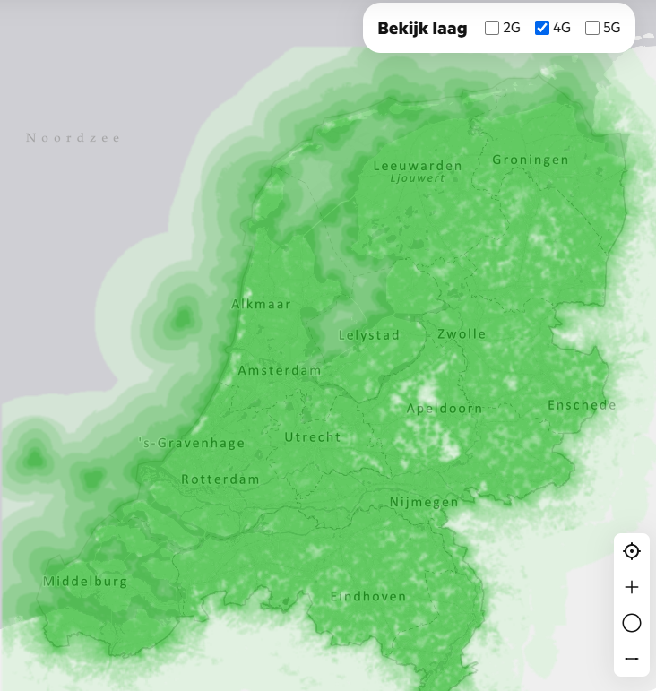

# Infrastructuuronderzoek – Casusanalyse

## 1. Beschrijving van de casus

Het doel van het project is om bodemverdichting op landbouwakkers te verminderen door middel van robotisering. Hiervoor wordt een autonome robotvloot ontwikkeld die het oogstproces zo efficiënt mogelijk moet uitvoeren.

### De robotvloot bestaat uit twee verschillende voertuigen en in totaal drie voertuigen:
* **Eén rooier:** oogst de gewassen en rijdt hiervoor heen en weer over de akker. Aan het einde van iedere rij keert de rooier op de kopakker.
* **Twee overslagwagens:** vervoeren de geoogste gewassen van de rooier naar het lospunt en rijden vervolgens terug naar de rooier.

### Ook maakt de robot vloot gebruik van twee operators:
* **Rooier operator:** bepaalt de snelheid van de overslagwagen en rooier tijdens de momenten dat ze naast elkaar rijden. De operator keert ook de rooier op keerpunten van de akker.
* **Overslagwagen operator:** De operator krijgt controle over de overslagwagen tijdens het ontladen van aardappels. Hiervoor kan hij de snelheid en richting van de wagen aanpassen.

Om bodemverdichting te beperken, moeten de overslagwagens zo efficiënt mogelijk over de akker rijden. Hierbij is het belangrijk dat ze niet meerdere keren over dezelfde plekken rijden, met uitzondering van de kopakker.

Om dit mogelijk te maken, moeten de robots onderling informatie kunnen uitwisselen en hun bewegingen op elkaar afstemmen. Hiervoor is een betrouwbare netwerkinfrastructuur nodig.

Binnen dit onderzoek wordt gekeken naar de communicatiebehoeften van de robotvloot en welke eisen dit stelt aan de netwerkinfrastructuur.

**Bronvermelding (APA 7)**
Katikaridis, D., Benos, L., Busato, P., Kateris, D., Papageorgiou, E., Karras, G., & Bochtis, D. (2025). Experimental comparative analysis of centralized vs. decentralized coordination of aerial–ground robotic teams for agricultural operations. _Robotics, 14_(9), Article 119. [https://doi.org/10.3390/robotics14090119](https://doi.org/10.3390/robotics14090119)

**Welke informatie moeten de robots uitwisselen?**
Denk hierbij aan locatiegegevens, snelheid, rijrichting, bunkerinhoud, geplande routes, taak informatie en de status van de voertuigen.

**Hoe vaak moet deze informatie worden uitgewisseld?**

Is het bijvoorbeeld noodzakelijk dat een robot iedere 100 milliseconden zijn locatie doorstuurt, of is een lagere updatefrequentie voldoende?

**Welke beslissingen nemen de robots zelfstandig?**

Moet een robot bij het detecteren van een obstakel wachten op instructies van de centrale controller, of kan deze zelfstandig reageren?

### 3. Analyse van de netwerkinfrastructuur

Naast de communicatiebehoeften moet worden onderzocht welke technische eisen nodig zijn voor het netwerk. Hiervoor zijn meerdere technologieen beschrikbaar en mogelijk zoals: Wifi, LoRa, 4G, 4G of bluetooth. Enkele van deze kunnen we al afstrepen bijvoorbeeld wifi heeft een ideale range van 50 meter (Bron 1). Wifi heeft de mogelijkheid voor grotere range doormiddel van gebruik van directional antennas, maar dat extra werk en hardware als er al een bestaand 4G/5G netwerk bestaad. Bluetooth kunnen we ook al afstrepen voor gelijke redenen en heeft maar een range van 10 meter (Bron 2). Voor de afstanden gaan we vanuit dat het alleen toegepast word in nederland met een maximale akker groote van 7.62 hectare (Bron 3) per perceel wat een akker groote geeft van 300 x 254 meter. Dus dit geeft ons de mogelijkheden tussen LoRa, 4G en 5G. Om erachter te komen welke technologie voor ons het best geschrikt is stellen we de volgende vragen per techniek:
*   Hoeveel data bits/s kunnen sturen tussen de robots
    *   Hoeveel data gaan we versturen
    *   Welke data gaan we versturen
*   Hoeveel vertraging in ms vind er plaats tussen sturen en ontvangen?
    *   Hoeveel en welke impact heeft vertraging
    *   Wat is maximale vetraging die we kunnen hebben
*   Hoeveel dekking is er in nederland voor 4g en 5g? (bron 4) 

    

### Bronnen:
* Bron 1: [https://en.wikipedia.org/wiki/Long-range_Wi-Fi](https://en.wikipedia.org/wiki/Long-range_Wi-Fi)  
"Wi-Fi networks have a range that's limited by the frequency, transmission power, antenna type, the location they're used in, and the environment.[1] A typical wireless router in an indoor point-to-multipoint arrangement using 802.11n and a stock antenna might have a range of 50 metres (160 ft) or less"
* Bron 2: [https://en.wikipedia.org/wiki/Bluetooth](https://en.wikipedia.org/wiki/Bluetooth)  
"In the most widely used mode, transmission power is limited to 2.5 milliwatts, giving it a very short range of up to 10 metres"
* Bron 3: [https://www.cbs.nl/nl-nl/maatwerk/2022/08/gemiddelde-oppervlakte-percelen-akkerbouwgewassen-2017-2021](https://www.cbs.nl/nl-nl/maatwerk/2022/08/gemiddelde-oppervlakte-percelen-akkerbouwgewassen-2017-2021)
* Bron 4: [https://www.kpn.com/netwerk/dekkingskaart](https://www.kpn.com/netwerk/dekkingskaart)

## 3. Analyse van de netwerkinfrastructuur

Naast de communicatiebehoeften moet worden onderzocht welke technische eisen aan het netwerk worden gesteld.

### 3.1 Netwerktechnologie

**Welke netwerktechnologie is geschikt voor de robotvloot?**

Kan de communicatie plaatsvinden via WiFi, 4G of 5G? En welke technologie sluit het beste aan bij de eisen van het project?

### 3.2 Netwerkbereik

**Hoe groot moet het bereik van het netwerk zijn?**

Moet de netwerkinfrastructuur het volledige landbouwperceel dekken, inclusief het lospunt, of is gedeeltelijke dekking voldoende?

### 3.3 Betrouwbaarheid

**Hoe betrouwbaar moet de netwerkverbinding zijn?**

Blijft de verbinding stabiel wanneer de robots over de akker bewegen? En wat gebeurt er wanneer een robot tijdelijk de verbinding verliest?

### 3.4 Netwerkcapaciteit

**Hoeveel netwerkcapaciteit heeft de robotvloot nodig?**

Hoeveel gegevens worden er tussen de robots en de controller uitgewisseld? Kan het netwerk deze gegevens gelijktijdig verwerken zonder dat er te veel vertraging ontstaat?
