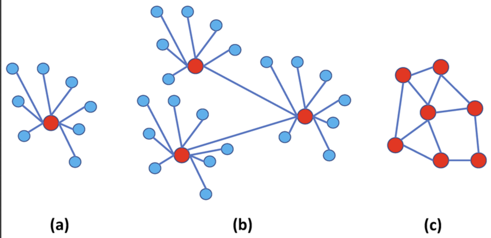

## Gecentraliseerde en gedecentraliseerde communicatie
voor het bepalen wat het meest geschikte communicatie en besturings-architectuur voor onze robotvloot zijn twee wetenschappelijke onderzoeken bekeken. hierin worden de verschillen tussen gecentraliseerde, gedecentraliseerde en hybride systemen besproken.

[figure 1, A comparison between (a) centralized, (b) decentralized, and (c) distributred]

**Onderzoek 1: Gecentraliseerde en gedecentraliseerde communicatie**
In het onderzoek van Katikaridis et al. (2025) worden twee verschillende communicatiearchitecturen voor landbouwrobots met elkaar vergeleken: een gecentraliseerd en een gedecentraliseerd systeem.

Bij een gedecentraliseerd systeem communiceren robots rechtstreeks met elkaar, zonder tussenkomst van een centrale controlunit. Bij een gecentraliseerd systeem verloopt de communicatie via een centraal systeem.

De onderzoekers hebben 120 praktijktesten uitgevoerd met een drone en een kleine autonome landbouwrobot. Hierbij werd gekeken naar de betrouwbaarheid en snelheid van de communicatie in een open veld en een boomgaard.

**Resultaten:**
uit het onderzoek bleek dat het gecentraliseerde systeem betrouwbaarder was in het afleveren van berichten. Dit systeem behaalde een succespercentage van maar liefst 97%. het gedecentraliseerde systeem behaalde 83% in het open veld en 70% in de boomgaard.

Het gedecentraliseerde systeem had bij het terugsturen van positiegegevens wel een lagere communicatie vertraging, daarin tegen ontstond er bij hun setup veel packet-loss en latency.

**Toepasbaarheid**
Dit onderzoek laat zien dat de gekozen communicatiearchitectuur invloed kan hebben op de betrouwbaarheid en vertraging van de communicatie.

voor onze robotvloot is betrouwbare communicatie belangrijk, omdat de rooier en overslagwagens voortdurend informatie moeten uitwissel over hun locatie,status en werkzaamheden.

Hoewel het onderzoek interessante resultaten oplevert, sluit de testopstelling niet volledig aan op onze casus. In het onderzoek werd gebruikgemaakt van een drone en een relatief kleine landbouwrobot. Onze robotvloot bestaat daarentegen uit een grote rooier en twee overslagwagens.
Door het verschil in afmetingen kunnen de antennes van onze landbouwmachines mogelijk hoger worden geplaatst, waardoor gewassen het radiosignaal minder snel blokkeren. Dit kan invloed hebben op de betrouwbaarheid van de communicatie.

De resultaten zijn daarom niet rechtstreeks toepasbaar op onze situatie, Daarom hebben we nog even verder gezocht!

**Onderzoek 2: Besturingsarchitecturen voor landbouwmachines**
In het onderzoek van Xia et al. (2026) worden drie verschillende besturingsarchitecturen voor landbouwmachines besproken: gecentraliseerd, gedecentraliseerd en hybride.

De onderzoekers vergelijken de eigenschappen en toepassingsmogelijkheden van de architectuur

**Resultaten:**
Volgens Xia et al. (2026) zijn gecentraliseerde architecturen vooral geschikt voor kleinere robotvloten met stabiele communicatieverbindingen.

**Gecentraliseerd**
Bij een gecentraliseerd systeem worden de taakverdeling  en globale routeplanning vanuit een centrale controller geregeld en gecommuniceerd. hierdoor beschikt het systeem een gezamelijk overzicht van de werkzaamheden en routes van de voertuigen.

Een nadeel is dat het systeem dan echt afhankelijk is van de centrale controller, wanneer deze uitvalt kan dat gevolgen hebben voor de gehele robotvloot. Zonder betrouwbare communcicatie en verbindingen zou een gecentraliseerde architectuur geen voordelen meer hebben.

**Gedecentraliseerd**
bij een gedecentraliseerd systeem nemen de robots zelfstandig beslissingen en stemmen ze hun werkzaamheden onderling af. hierdoor zijn ze minder afhankelijk van een centraal systeem, maar is het wel lastiger om de werkzaamheden van de gehele robotvloot te optimaliseren en af te stemmen.

Een hybride architectuur combineert centrale coördinatie met lokale zelfstandigheid van de voertuigen.

**Toepasbaarheid**
Uit dit onderzoek blijkt dat de ophang van de robotvloot en de behoefte aan een gezamelijke planning belangrijke factoren zijn bij het kiezen van de besturingsarchitectuur.

Onze robotbloot bestaat uit slechts drie voertuigen. hierdoor verwachten wij dat de beperking van een gecentraliseerd systeem op het gebied van schaalbaarheid minimale invloed zou hebben.

Daarnaast is gazemelijke routeplanning en afstemming belangerijk om onnodige bodemverdichting te vermijden. Met een centrale controller kunnen de posities en routes gezamelijk bijgehouden worden, waardoor je de routeplanning makkelijker en effecienter kan afstemmen.

**Conclusie**
Op basis van beide onderzoeken lijkt een gecentraliseerde besturingsarchitectuur het meest geschikt voor onze robotvloot. Door de kleine omvang van de vloot en de behoefte aan gezamenlijke routeplanning verwachten wij dat centrale coördinatie de meest efficiënte oplossing is.

Een belangrijk aandachtspunt blijft de afhankelijkheid van betrouwbare communicatie. Daarom gaan we verder onderzoeken welke netwerkinfrastructuur hiervoor het meest geschikt is.

Daarnaast ontstaat de vraag: 
**Waar kan de centrale controlunit het beste worden geplaatst: op de rooier of op een vaste locatie buiten het landbouwperceel?**

**Welke invloed heeft de plaatsing van de draadloze infrastructuur op de communicatie betrouwbaarheid?**

Dit onderzoek geeft ons daarom een belangrijke onderbouwing voor de keuze van een gecentraliseerde architectuur.