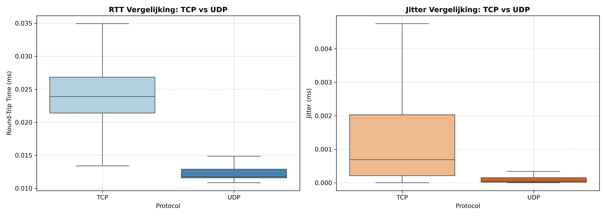
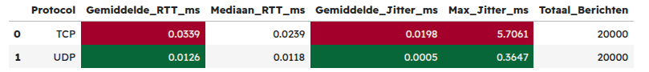

# Uitvoering
Om deze vraag te beantwoorden zijn twee identieke client/server-architecturen opgezet in C++, waarbij respectievelijk het TCP-protocol (`SOCK_STREAM`) en het UDP-protocol (`SOCK_DGRAM`) is ingezet. Per protocol zijn 20.000 berichten verwerkt in een gecontroleerde testomgeving. De resulterende round-trip time (RTT) en inter-packet jitter zijn geregistreerd in CSV-bestanden en geanalyseerd via Python (Pandas en Seaborn). De volgende resultaten kwamen daaruit tevoorschijn:

# Analyse
Zoals te zien is in figuur 1, vertoont het UDP-protocol aanzienlijk gunstigere prestaties op zowel latency als stabiliteit. In figuur 2 kunnen we de exacte waardes uitlezen:
*   **Gemiddelde RTT:** UDP heeft een gemiddelde RTT van 0.0126 ms, ten opzichte van 0.0339 ms bij TCP. Dat is maar liefst 2.7 keer zo snel.
*   **Mediaan RTT:** De mediaan bevestigt dit beeld (0.0118 ms voor UDP tegenover 0.0239 ms voor TCP).
*   **Jitter (oftewel stabiliteit):** De gemiddelde jitter bij UDP bedraagt verwaarloosbaar 0.0005 ms met een maximale uitschieter van 0.3647 ms. Daarentegen kent TCP een gemiddelde jitter van 0.0198 ms en extreme pieken tot wel 5.7061 ms.

# Bijlagen

(Figuur 1: Boxplot met vergelijkingen van de RTT en jitter tussen TCP en UDP)
 

(Figuur 2: Tabel met de harde waardes van de vergelijkingen van de RTT en jitter tussen TCP en UDP)