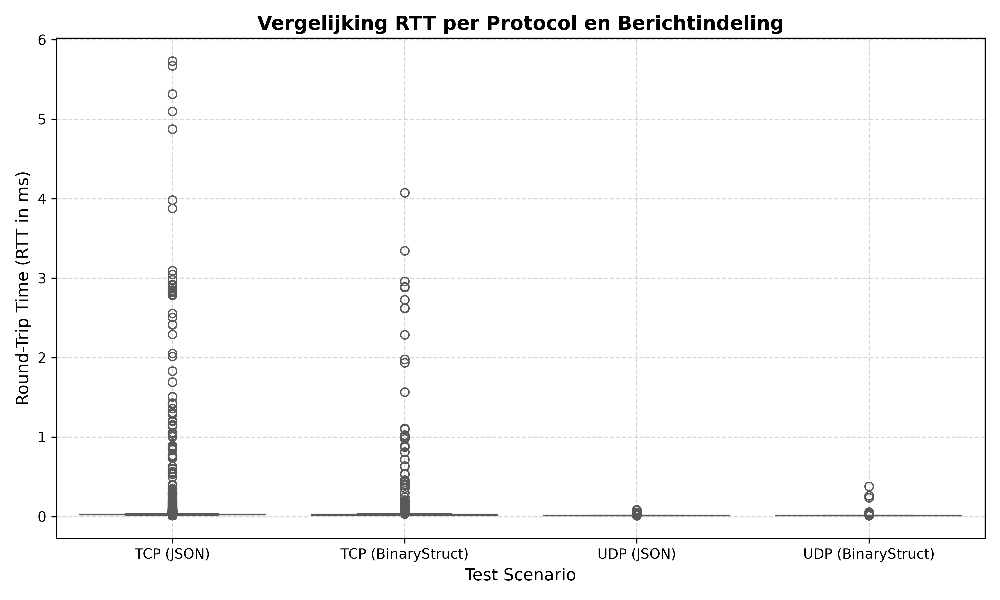
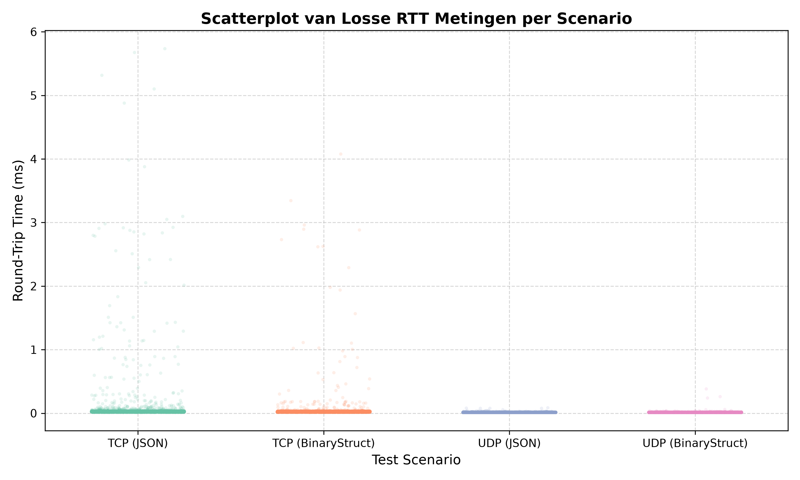

# Analyse
Om een totaalbeeld te vormen zijn alle vier de mogelijke combinaties (TCP + JSON, TCP + Struct, UDP + JSON, UDP + Struct) doorgemeten met runs van elk 10.000 berichten (totaal 40.000 datapunten).

Zoals te observeren is in het boxplot van figuur 1, presteren de UDP-varianten consistent op de onderste grens van de latencyschaal, ongeacht het gekozen berichtformaat. In hetzelfde boxplot is te zien dat TCP flinke uitschieters kent tot boven de 5 ms, terwijl UDP heel strak en consistent binnen de sub-milliseconde waarden blijft.

Binnen het scatterplot in figuur 2 valt ook te zien dat de TCP varianten veel wazige vliegers hebben, terwijl de UDP varianten daar geen last van hebben.

# Bijlage

(Figuur 1: Boxplots waar de RTT uitschieters bij TCP heel zichtbaar hoog en veel zijn terwijl UDP nauwelijks uitschieters heeft)
 

(Figuur 2: Scatterplot waar de punten transparant zijn. Hier is goed te zien waar de meeste punten zich bevinden)
 