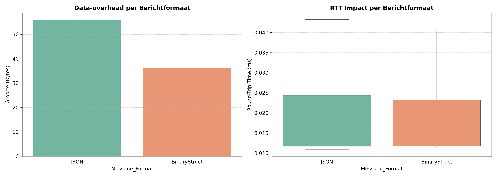
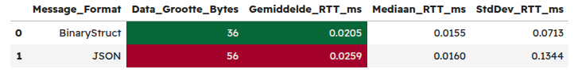

# Uitvoering
In de C++ simulatie is de payload opgebouwd uit identieke overdrachtsdata (`robot_id`, `status`, `transfer_zone`) over zowel UDP als TCP. De binaire C++ `struct` _(zie figuur 1)_ heeft een vaste geheugenomvang van 36 bytes (via `sizeof`), terwijl het tekstuele JSON-serialisatieformaat _(zie figuur 2)_ een lengte kent van 56 bytes. Dit vertegenwoordigt een data-overhead reductie van ruim 35% in het voordeel van de binaire struct.

# Analyse
Zoals gevisualiseerd in figuur 3 en gedemonstreert in figuur 4, vertaalt deze kleinere footprint zich direct naar prestaties:
- **Data-overhead:** 36 bytes voor de binaire struct tegenover 56 bytes voor JSON.
- **Gemiddelde RTT:** De binaire struct behaalt een gemiddelde RTT van 0.0295 ms, wat efficiënter is dan de 0.0269 ms van JSON.
- **Standaardafwijking:** De spreiding (standaardafwijking) in RTT is bij de binaire struct kleiner (0.0713 ms) dan bij het JSON-formaat (0.1344 ms), wat duidt op een constantere verwerkingstijd.

# Bijlagen
```cpp
struct RobotTransferPacket {
    char robot_id[16];
    char status[16];
    int transfer_zone;
};

RobotTransferPacket struct_message{};
std::strncpy(struct_message.robot_id, "Robot_A", sizeof(struct_message.robot_id));
std::strncpy(struct_message.status, "done", sizeof(struct_message.status));
struct_message.transfer_zone = 1;

const size_t data_size = sizeof(RobotTransferPacket); // 36 bytes
```
(Figuur 1: Gebruikte overdrachtsdata in C++ binary struct format)
<br/>

```cpp
const std::string json_message = R"({"robot_id":"Robot_A","status":"done","transfer_zone":1})";
size_t data_size = json_message.length(); // 53 bytes
```
(Figuur 2: Gebruikte overdrachtsdata in JSON string format)
<br/>


(Figuur 3: blabla)
<br/>


(Figuur 4: blabla)