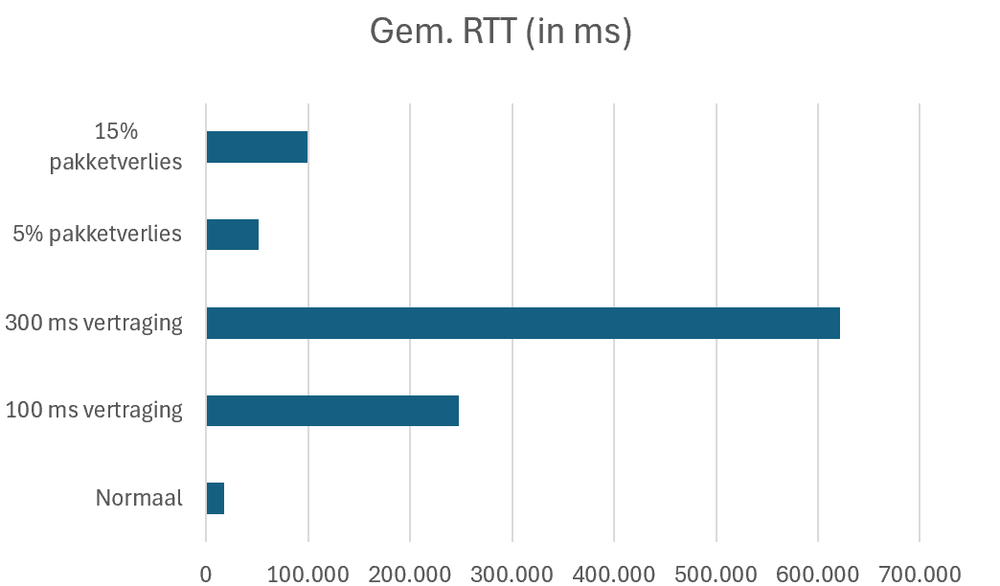

# 3. Data verzamelen

## 3.1 Inleiding

In deze fase van ons faseplan wordt onderzocht hoe twee robotvloten (/ robots) informatie met elkaar kunnen uitwisselen en hoe het transportsysteem betrouwbaar kan blijven werken wanneer het gedeelde overdrachtspunt tijdelijk niet beschikbaar is (door bijvoorbeeld: onderhoud of schoonmaak).

Voor het beantwoorden van de deelvragen is gebruikgemaakt van technische documentatie en wetenschappelijk onderzoek. Hierbij is gekeken naar communicatie tussen automatische voertuigen, verschillende communicatietechnieken en manieren om berichtenverlies, vertragingen en netwerkuitval op te vangen.

De verzamelde informatie wordt per deelvraag besproken. Vervolgens worden de mogelijke oplossingen vergeleken om te bepalen welke technieken het beste aansluiten bij de situatie van Viscon Group.

## 3.2 Deelvraag 1: Welke informatie moeten de twee robotvloten(/ robots) met elkaar uitwisselen om het transport via het gedeelde overdrachtspunt goed te laten verlopen?

Om transport tussen twee gescheiden robotvloten(/robots) goed te laten verlopen, moet het systeem niet alleen weten welke goederen moeten worden vervoerd, maar ook wat de actuele status van het overdrachtspunt en de betrokken transportopdrachten is.

Chen et al. (2020) beschrijven hoe automatische voertuigen en andere geautomatiseerde systemen hun werkzaamheden moeten afstemmen om transporttaken efficiënt uit te voeren. Hun onderzoek laat zien dat de planning van verschillende voertuigen onderling afhankelijk is. Dit is ook relevant voor Viscon Group, omdat beide robotvloten(/robots) hetzelfde overdrachtspunt gebruiken en transportopdrachten in beide richtingen moeten uitvoeren.

Op basis hiervan zijn vijf categorieën informatie belangrijk.

### 3.2.1 Status van het overdrachtspunt

De robotvloten(/ robots) moeten kunnen vaststellen of het overdrachtspunt beschikbaar is voor een nieuwe overdracht.

De status moet minimaal onderscheid maken tussen beschikbaar, bezet, gesloten voor reiniging of onderhoud, en buiten gebruik door een storing. Daarnaast is het belangrijk dat bekend is wanneer de status voor het laatst is bijgewerkt.

Wanneer het overdrachtspunt tijdelijk gesloten is, moeten beide robotvloten(/ robots) deze wijziging ontvangen. Zo wordt voorkomen dat een robot met een nieuwe overdracht begint terwijl het overdrachtspunt niet beschikbaar is.

Alleen een melding dat het overdrachtspunt beschikbaar is, is niet voldoende. Het systeem moet ook voorkomen dat beide robotvloten(/ robots) tegelijkertijd aanspraak maken op dezelfde overdrachtsmogelijkheid. Hiervoor moet een overdracht kunnen worden gereserveerd en bevestigd.

### 3.2.2 Transportopdrachten

Voor iedere transportopdracht moet duidelijk zijn wat er moet worden vervoerd en tussen welke zones de overdracht plaatsvindt.

De volgende gegevens zijn hiervoor nodig:

- Een uniek identificatienummer van de transportopdracht.
- De identificatie van het goed, de krat of de pallet.
- De brongebied en de bestemmingsgebied.
- De prioriteit van de opdracht en eventueel de gewenste uitvoeringstijd.
- De actuele status van de opdracht, bijvoorbeeld aangemaakt, toegewezen, wachtend op overdracht, overgedragen of afgerond.

Met een uniek identificatienummer kan het systeem herkennen of een ontvangen bericht bij een bestaande opdracht hoort. Dit helpt voorkomen dat dezelfde transportopdracht meerdere keren wordt aangemaakt of uitgevoerd.

De opdracht moet bovendien altijd de juiste bron- en bestemmingszone bevatten. Een robotvloot mag uitsluitend opdrachten uitvoeren die binnen de eigen hygiënezone vallen. De overdracht tussen zones moet via het daarvoor aangewezen overdrachtspunt plaatsvinden.

### 3.2.3 Status en beschikbaarheid van robots

De robotvloten(/ robots) moeten voldoende informatie uitwisselen om te bepalen of een transportopdracht kan worden uitgevoerd.

Daarvoor zijn met name de beschikbaarheid van een robot, de actuele opdrachtstatus en eventuele storingen relevant. Een indicatie van de verwachte aankomsttijd kan daarnaast helpen om transportopdrachten beter op elkaar af te stemmen.

Wanneer een robot vertraagd is of een storing heeft, kan het systeem daarmee rekening houden. Het kan bijvoorbeeld een opdracht uitstellen, een andere geschikte robot inzetten of voorkomen dat het overdrachtspunt onnodig lang bezet blijft.

Niet alle interne robotgegevens hoeven hiervoor te worden uitgewisseld. Alleen informatie die nodig is voor de transportcoördinatie hoeft tussen de robotvloten(/ robots) beschikbaar te zijn.

### 3.2.4 Bevestigingen van overdrachten

Het systeem moet kunnen vaststellen of een transportopdracht daadwerkelijk is uitgevoerd.

Daarvoor zijn bevestigingen nodig bij belangrijke momenten in het overdrachtsproces. Denk aan het accepteren van een opdracht, het gereedzetten van een goed, het overnemen van het goed door de ontvangende robotvloot en het afronden van de overdracht.

Een ontvangen bericht betekent namelijk niet automatisch dat de fysieke overdracht is uitgevoerd. De status van de transportopdracht moet daarom pas worden gewijzigd wanneer de bijbehorende stap daadwerkelijk is bevestigd.

Iedere overdracht moet daarnaast worden geregistreerd met het tijdstip, de betrokken robots en het gebruikte overdrachtspunt. Dit sluit aan bij de randvoorwaarden van Viscon Group, waarin achteraf aantoonbaar moet zijn hoe een overdracht heeft plaatsgevonden.

### 3.2.5 Actualiteit van informatie en verbindingsstatus

Ten slotte moet het systeem kunnen vaststellen of de ontvangen informatie nog actueel is.

Bij belangrijke berichten zijn daarom een tijdstip, een uniek bericht- of opdrachtnummer en eventueel een versienummer van de status nuttig. Hierdoor kan het systeem herkennen dat een ontvangen bericht ouder is dan de informatie die al beschikbaar is.

Ook moet duidelijk zijn wanneer een robotvloot of communicatiesysteem niet meer bereikbaar is. Hiervoor kunnen periodieke statusberichten of heartbeats worden gebruikt.

Als de verbinding uitvalt en de actuele status van het overdrachtspunt niet meer kan worden vastgesteld, mag het systeem niet zonder meer aannemen dat het overdrachtspunt nog beschikbaar is.

### Antwoord op deelvraag 1

 
De twee robotvloten moeten berichten uitwisselen om transportopdrachten, het gedeelde overdrachtspunt en de voortgang van overdrachten te coördineren. Op basis van de onderzochte informatie zijn de volgende technische eisen opgesteld.
**1. Status van het overdrachtspunt**
Het systeem moet de status van het overdrachtspunt bijhouden. Hiervoor zijn minimaal de statussen `OPEN`, `RESERVED`, `CLOSED` en `FAULT` nodig. Bij `OPEN` is het punt beschikbaar, bij `RESERVED` is het gereserveerd (voor bijvoorbeeld een overdracht), bij `CLOSED` is het gesloten voor bijvoorbeeld reiniging of onderhoud en bij `FAULT` is er een storing.
Voordat een overdracht begint, moet het systeem controleren of het overdrachtspunt beschikbaar is en correct is gereserveerd. Beide robotvloten moeten statuswijzigingen ontvangen. Als de status onbekend is of niet betrouwbaar kan worden vastgesteld, mag geen nieuwe overdracht worden gestart.
**2. Transportopdrachten**
Iedere transportopdracht moet minimaal de volgende gegevens bevatten:
*   Een uniek opdracht-ID.
    
*   De identificatie van het te vervoeren goed, de krat of de pallet.
    
*   De bron- en bestemmingszone.
    
*   De actuele status van de opdracht.
    
*   Een tijdstempel van het bericht.
    
De opdrachtstatus moet aangeven of een opdracht bijvoorbeeld is aangemaakt, geaccepteerd, wachtend op overdracht of afgerond. Het systeem moet aan de hand van het opdracht-ID kunnen controleren of een opdracht al eerder is ontvangen of verwerkt. Hierdoor wordt voorkomen dat een opnieuw ontvangen bericht automatisch leidt tot een dubbele uitvoering.
**3. Beschikbaarheid van robots**
De robotvloten moeten informatie kunnen uitwisselen over de beschikbaarheid van robots, actieve transportopdrachten en eventuele storingen. Indien nodig kan ook de verwachte aankomsttijd worden meegestuurd om het gebruik van het overdrachtspunt te coördineren.
Een robot mag alleen opdrachten uitvoeren die binnen de eigen hygiënezone vallen. Het overdrachtspunt vormt de aangewezen locatie voor overdrachten tussen de zones.
**4. Bevestigingen van berichten en overdrachten**
Het systeem moet onderscheid maken tussen een bevestiging dat een bericht is ontvangen en een bevestiging dat een fysieke overdracht is uitgevoerd. Belangrijke gebeurtenissen, zoals het accepteren van een opdracht, het reserveren van het overdrachtspunt en het afronden van een overdracht, moeten afzonderlijk worden geregistreerd.
Iedere gebeurtenis moet gekoppeld zijn aan het betreffende opdracht-ID en een tijdstempel bevatten. Hierdoor kan achteraf worden vastgesteld welke stappen zijn uitgevoerd en waar eventuele vertragingen of fouten zijn ontstaan.
**5. Actualiteit en verbindingsstatus**
Berichten moeten een tijdstempel en een unieke identificatie bevatten. Voor statusupdates moet het systeem kunnen bepalen of een bericht nieuwer is dan de laatst verwerkte status. Dit voorkomt dat verouderde informatie een recentere status overschrijft.
Daarnaast moeten de robotvloten periodiek statusberichten (_heartbeats_) versturen. Wanneer deze berichten gedurende een ingestelde termijn uitblijven, moet het systeem de verbinding als mogelijk verstoord markeren.
**6. Afhandeling van netwerkuitval**
Wanneer de verbinding wegvalt, moeten nog niet afgeronde transportopdrachten geregistreerd blijven. Na herstel van de verbinding moeten de robotvloten hun actuele status en openstaande opdrachten controleren voordat het transport wordt hervat.
Als niet kan worden vastgesteld of het overdrachtspunt beschikbaar is, moet het systeem wachten totdat de status opnieuw betrouwbaar bekend is. Het opnieuw ontvangen van een opdracht mag niet automatisch leiden tot een tweede uitvoering.
Deze technische eisen bepalen welke gegevens de robotvloten moeten uitwisselen en welke controles nodig zijn om het tweerichtingsvervoer betrouwbaar te coördineren. Ze vormen tevens de basis voor het ontwerp van het prototype en de bijbehorende tests.

## 3.3 Deelvraag 2: Welke communicatietechnieken zijn het meest geschikt voor het uitwisselen van informatie tussen de twee robotvloten(/ robots)?

Om deze deelvraag te beantwoorden, zijn drie communicatietechnieken onderzocht: TCP-sockets, MQTT en ROS 2 met DDS.

Deze technieken bieden verschillende mogelijkheden. TCP levert een betrouwbare gegevensverbinding, MQTT is gericht op berichtenuitwisseling via een broker en ROS 2 biedt communicatiefuncties die specifiek aansluiten bij robotica.

### 3.3.1 TCP-sockets

TCP is een transportprotocol dat een betrouwbare, geordende gegevensstroom tussen twee endpoints ondersteunt. Het protocol detecteert onder andere verloren gegevens en gebruikt hertransmissies om de betrouwbaarheid van de verbinding te verbeteren (IETF, 2022).

Een TCP-verbinding kan daarom geschikt zijn voor het rechtstreeks uitwisselen van transportopdrachten en bevestigingen tussen twee systemen.

Een belangrijk nadeel is dat TCP alleen de gegevensoverdracht regelt. De applicatie moet zelf bepalen hoe berichten worden opgebouwd, hoe opdrachten worden geïdentificeerd en hoe de communicatie wordt hersteld nadat een verbinding wegvalt.

Ook moeten functies zoals berichtbevestigingen op toepassingsniveau, het herkennen van dubbele opdrachten en het controleren van verouderde informatie zelf worden ontworpen.

TCP is daarmee een mogelijke oplossing wanneer beide robotvloten(/ robots) een eigen, rechtstreeks communicatieprotocol gebruiken. Voor een systeem met meerdere partijen die zich op verschillende soorten berichten abonneren, is een aanvullende berichtenarchitectuur nodig.

### 3.3.2 MQTT

MQTT is een lichtgewicht communicatieprotocol dat werkt met een publish/subscribe-model. Een verzender publiceert berichten bij een broker, waarna systemen die op de betreffende onderwerpen zijn geabonneerd de berichten kunnen ontvangen.

Hierdoor hoeven de twee robotvloten(/ robots) niet voortdurend rechtstreeks met elkaar verbonden te zijn. Beide kunnen bijvoorbeeld informatie over het overdrachtspunt publiceren en zich abonneren op de berichten die voor hun eigen transportplanning relevant zijn.

MQTT ondersteunt drie kwaliteitsniveaus voor berichtaflevering (OASIS, 2019):

| QoS-niveau | Werking | Geschikt voor |
|---|---|---|
| QoS 0 | Een bericht wordt maximaal één keer afgeleverd; verlies is mogelijk. | Niet-kritieke statusupdates waarbij een volgende update het verlies kan opvangen. |
| QoS 1 | Een bericht wordt ten minste één keer afgeleverd; dubbele ontvangst is mogelijk. | Transportopdrachten en belangrijke statusmeldingen wanneer de applicatie dubbele berichten correct verwerkt. |
| QoS 2 | Het protocol gebruikt een uitgebreidere uitwisseling om een bericht precies één keer af te leveren. | Berichten waarbij dubbele of verloren berichtaflevering niet aanvaardbaar is en de extra communicatieoverhead gerechtvaardigd is. |

MQTT 5.0 ondersteunt daarnaast onder andere het instellen van een verlooptermijn voor berichten. Hierdoor kunnen berichten die te lang bij de broker hebben gewacht, verlopen voordat ze bij een ontvanger worden afgeleverd.

Dit is belangrijk voor Viscon Group. Een oude melding dat het overdrachtspunt beschikbaar is, mag bijvoorbeeld niet alsnog worden gebruikt nadat het punt inmiddels voor onderhoud is gesloten.

Een aandachtspunt is dat de broker een belangrijk onderdeel van de communicatie wordt. Als deze niet bereikbaar is, kan de berichtuitwisseling worden onderbroken. De beschikbaarheid van de broker en de afhandeling van verbindingsproblemen moeten daarom in het ontwerp worden meegenomen.

Ook garandeert QoS 2 niet dat een fysieke transportopdracht over alle systemen en na iedere mogelijke storing precies één keer wordt uitgevoerd. Daarvoor zijn aanvullende controles op opdrachtniveau nodig.

### 3.3.3 ROS 2 met DDS

ROS 2 is een softwareframework voor robotica. De communicatie gebruikt middleware op basis van DDS, waarmee berichten tussen verschillende onderdelen van een robotsysteem kunnen worden uitgewisseld.

ROS 2 biedt verschillende Quality of Service-instellingen waarmee het gedrag van de communicatie kan worden afgestemd op de toepassing (Open Robotics, z.d.).

Belangrijke instellingen zijn:

- **Reliability:** bepaalt of berichten zo betrouwbaar mogelijk worden afgeleverd of dat het systeem minder betrouwbare, maar mogelijk lichtere communicatie gebruikt.
- **Lifespan:** bepaalt hoe lang een bericht bruikbaar blijft. Berichten die verlopen zijn voordat ze worden ontvangen, worden niet afgeleverd.
- **Deadline:** geeft aan met welke maximale tussenpozen berichten worden verwacht.
- **Liveliness:** helpt vaststellen of een communicatieonderdeel nog actief is.

Met deze instellingen kan een robotsysteem onderscheid maken tussen actuele en verouderde informatie. Ook kan het systeem signaleren wanneer een communicatieonderdeel niet meer op tijd berichten verstuurt.

Een belangrijk aandachtspunt is dat de Quality of Service-instellingen op elkaar moeten aansluiten. Incompatibele instellingen kunnen ervoor zorgen dat berichten niet worden afgeleverd.

ROS 2 met DDS is vooral interessant als de robotvloten(/ robots) al op ROS 2 zijn gebaseerd. In dat geval kan gebruik worden gemaakt van bestaande robotcommunicatie en de bijbehorende configuratiemogelijkheden. Wanneer de robotvloten(/ robots) verschillende gesloten leverancierssystemen gebruiken, moet eerst worden onderzocht of integratie mogelijk is.

### 3.3.4 Vergelijking van de communicatietechnieken

De drie technieken kunnen op basis van de gevonden documentatie als volgt worden vergeleken.

| Criterium | TCP-sockets | MQTT 5.0 | ROS 2 met DDS |
|---|---|---|---|
| Communicatiemodel | Rechtstreekse gegevensverbinding | Publish/subscribe via broker | Robotgerichte communicatie tussen nodes |
| Betrouwbare berichtoverdracht | Ja, op transportniveau | Instelbaar via QoS 0, 1 of 2 | Instelbaar via Quality of Service |
| Berichten laten verlopen | Zelf implementeren op applicatieniveau | Ondersteund via berichtvervaltermijn | Ondersteund via de lifespan-instelling |
| Afhandeling van dubbele opdrachten | Zelf implementeren | Nodig bij onder andere QoS 1 | Afhandeling op applicatieniveau blijft nodig |
| Afhankelijkheden | Eigen protocol en verbindingsbeheer | Broker en MQTT-clients | ROS 2-, DDS- en netwerkconfiguratie |
| Toepassing bij Viscon | Mogelijk voor een eigen communicatieprotocol | Geschikt voor uitwisseling van status en transportgebeurtenissen tussen systemen | Vooral geschikt wanneer de robotvloten(/ robots) al ROS 2 gebruiken |

De tabel is een vergelijking op basis van de documentatie en protocolkenmerken. Er zijn nog geen metingen uitgevoerd waarmee de daadwerkelijke vertraging of prestaties van deze technieken binnen de installatie van Viscon Group kunnen worden vastgesteld.

### Antwoord op deelvraag 2

Op basis van de onderzochte communicatietechnieken zijn TCP-sockets, MQTT en ROS 2 met DDS alle drie geschikt voor het uitwisselen van informatie tussen afzonderlijke systemen. De verschillen zitten voornamelijk in de manier waarop berichten worden verstuurd, de beschikbare betrouwbaarheidsinstellingen en de hoeveelheid functionaliteit die zelf moet worden geïmplementeerd.

TCP-sockets bieden betrouwbare en geordende gegevensoverdracht, maar vereisen dat de applicatie zelf verantwoordelijk is voor de berichtstructuur, bevestigingen op opdrachtniveau en het herstellen van de communicatie na een verbindingsstoring. Hierdoor moet relatief veel functionaliteit zelf worden ontwikkeld.
MQTT sluit goed aan op de situatie van Viscon Group, omdat het publish/subscribe-model het mogelijk maakt om transportopdrachten en statusupdates via een centrale broker uit te wisselen. Beide robotvloten kunnen zich abonneren op relevante berichten, zoals wijzigingen in de status van het overdrachtspunt en nieuwe transportopdrachten. Daarnaast bieden QoS-instellingen en berichtvervaltermijnen mogelijkheden om de berichtafhandeling betrouwbaarder te maken. Wel blijft de beschikbaarheid van de broker een belangrijk aandachtspunt.

ROS 2 met DDS biedt uitgebreide mogelijkheden voor communicatie binnen robotsystemen. De verschillende Quality of Service-instellingen maken het mogelijk om communicatie af te stemmen op de eisen van het transportsysteem. Deze techniek is vooral geschikt wanneer de robotvloten al gebruikmaken van ROS 2. Wanneer de bestaande robotsoftware andere communicatiesystemen gebruikt, moet eerst worden onderzocht of integratie mogelijk is.
Voor het softwareprototype is gekozen voor TCP-socketcommunicatie. Hiermee kan een directe verbinding tussen een client en server worden opgezet, waarmee de invloed van netwerkvertragingen en pakketverlies op de gegevensuitwisseling kan worden onderzocht.

Het prototype maakt geen gebruik van MQTT. De specifieke functionaliteiten van MQTT, zoals de broker, het publish/subscribe-model en de Quality of Service-instellingen, worden daarom niet praktisch getest.
Omdat MQTT gebruikmaakt van TCP/IP, kunnen de resultaten van het TCP-prototype wel inzicht geven in het gedrag van een onderliggende TCP-verbinding. De resultaten kunnen echter niet worden gebruikt om de specifieke betrouwbaarheid van MQTT te beoordelen.

## 3.4 Deelvraag 3: Hoe kan betrouwbare communicatie tussen de twee robotvloten(/ robots) worden bewaard bij vertragingen of tijdelijke netwerkuitval?

Uit de technische documentatie blijkt dat een betrouwbare communicatieoplossing uit meerdere onderdelen moet bestaan. Alleen een protocol gebruiken dat berichten kan herverzenden, is niet voldoende. Het systeem moet ook omgaan met oude berichten, dubbele opdrachten en een tijdelijk onbereikbare robotvloot.

### 3.4 Deelvraag 3: Welke invloed hebben netwerkvertraging en gesimuleerd pakketverlies op de prestaties en betrouwbaarheid van de TCP-communicatie tussen de twee robotvloten?

Om deze deelvraag te beantwoorden, is een softwareprototype ontwikkeld waarmee TCP-communicatie tussen een client en server kan worden getest. Met dit prototype wordt onderzocht hoe de communicatie reageert op verschillende netwerkcondities.
Tijdens het onderzoek zijn verschillende situaties nagebootst, waaronder normale communicatie, toegevoegde netwerkvertraging en pakketverlies. De resultaten worden gebruikt om te bepalen welke invloed deze omstandigheden hebben op de rondreistijd (RTT) en het succespercentage van de communicatie.

#### 3.4.1 Onderzoeksopstelling en werkwijze

Voor het uitvoeren van de tests is een softwareprototype ontwikkeld in C++. Het prototype maakt gebruik van TCP-sockets om gegevens tussen een client en server uit te wisselen.
Tijdens de communicatie wordt de RTT gemeten. Dit is de tijd tussen het versturen van een bericht en het ontvangen van het bijbehorende antwoord.
Om de invloed van netwerkproblemen te onderzoeken, zijn verschillende netwerkcondities ingesteld. Hierbij is gebruikgemaakt van toegevoegde vertragingen en gesimuleerd pakketverlies.
Iedere testconditie is drie keer uitgevoerd. Hierdoor kunnen de resultaten van verschillende uitvoeringen met elkaar worden vergeleken en wordt voorkomen dat de conclusie afhankelijk is van één enkele meting.
De verzamelde meetgegevens zijn opgeslagen in een [spreadsheet]([statistieken.xlsx](https://avans-my.sharepoint.com/:x:/g/personal/s_laurijssen2_student_avans_nl/IQARPnnsQr9BQ7Xket6rRxpYAQzO5nacXhXmG9ewMBpQoa8?e=w4IBSv)). Hierin zijn de gemiddelde RTT, minimale RTT, maximale RTT en het succespercentage bijgehouden.

#### 3.4.2 Uitgevoerde testscenario's

Voor het testen van de TCP-communicatie zijn de volgende testscenario's uitgevoerd:
| Testscenario | Beschrijving |
| --- | --- |
| Normaal | Communicatie zonder toegevoegde netwerkproblemen. |
| 100 ms vertraging | Er wordt 100 ms netwerkvertraging toegevoegd. |
| 300 ms vertraging | Er wordt 300 ms netwerkvertraging toegevoegd. |
| 5% pakketverlies | Er wordt 5% pakketverlies gesimuleerd. |
| 15% pakketverlies | Er wordt 15% pakketverlies gesimuleerd. |
Alle bovenstaande scenario's zijn drie keer uitgevoerd. Per uitvoering zijn de meetresultaten vastgelegd.

#### 3.4.3 Meetresultaten

De resultaten laten verschillen zien tussen de verschillende testscenario's. Vooral de toegevoegde netwerkvertraging en het pakketverlies hebben invloed op de gemiddelde RTT.
In tabel 1 staat een overzicht van de gemiddelde RTT, de minimale en maximale RTT van de eerste meetrun en het succespercentage per testconditie.
| Testconditie | Gem. RTT (ms) | Min. - max. RTT eerste meting (ms) | Succespercentage |
| --- | --- | --- | --- |
| Normaal | 17,722 | 5,719 - 264,330 | 100% |
| 100 ms vertraging | 247,813 | 203,071 - 778,337 | 100% |
| 300 ms vertraging | 621,687 | 604,553 - 1060,785 | 100% |
| 5% pakketverlies | 51,808 | 5,796 - 2361,043 | 100% |
| 15% pakketverlies | 99,579 | 7,642 - 2415,511 | 100% |

_Tabel 1: Overzicht van de gemeten TCP-communicatie per testconditie._
De gemiddelde RTT is berekend aan de hand van de drie uitgevoerde meetruns. De afzonderlijke meetresultaten zijn opgenomen in de bijbehorende spreadsheet.

_Grafiek 1: Overzicht van de RTT TCP-communicatie onder verschillende condities_
De gemiddelde RTT is berekend aan de hand van de drie uitgevoerde meetruns.

#### 3.4.4 Analyse van de resultaten

Uit de resultaten blijkt dat de gemiddelde RTT bij normale communicatie 17,722 ms bedraagt. Dit vormt de uitgangssituatie waarmee de andere testscenario's worden vergeleken.
Bij een toegevoegde vertraging van 100 ms stijgt de gemiddelde RTT naar 247,813 ms. Bij 300 ms vertraging neemt deze verder toe tot 621,687 ms. Dit laat zien dat de toegevoegde netwerkvertraging een duidelijke invloed heeft op de tijd die nodig is om een bericht uit te wisselen.
Ook pakketverlies heeft invloed op de communicatie. Bij 5% pakketverlies bedraagt de gemiddelde RTT 51,808 ms. Wanneer het pakketverlies wordt verhoogd naar 15%, stijgt de gemiddelde RTT naar 99,579 ms.
Bij alle uitgevoerde testscenario's is een succespercentage van 100% geregistreerd. Volgens de meetregistratie zijn alle berichten dus succesvol uitgewisseld, ondanks de toegevoegde netwerkproblemen.
De hogere RTT bij pakketverlies kan erop wijzen dat TCP extra tijd nodig heeft om verloren gegevens opnieuw te verzenden. TCP beschikt namelijk over mechanismen om verloren gegevens te herstellen. Hierdoor kan de applicatie uiteindelijk wel een volledig bericht ontvangen, terwijl de onderliggende communicatie vertraging heeft opgelopen.

#### 3.4.5 Antwoord op deelvraag 3

Uit de uitgevoerde tests blijkt dat netwerkvertraging en pakketverlies invloed hebben op de prestaties van de TCP-communicatie.
Bij toegevoegde vertraging stijgt de gemiddelde RTT duidelijk. Ook bij een hoger percentage pakketverlies neemt de gemiddelde RTT toe. Ondanks deze netwerkproblemen is tijdens de uitgevoerde tests een succespercentage van 100% gemeten.
Dit laat zien dat de TCP-communicatie binnen de gebruikte testopstelling berichten succesvol kan uitwisselen onder verschillende netwerkcondities. Wel neemt de benodigde tijd voor het uitwisselen van berichten toe wanneer de netwerkcondities slechter worden.
De resultaten geven daarmee inzicht in de betrouwbaarheid en prestaties van TCP-communicatie. Over het detecteren en herstellen van een volledige netwerkonderbreking kunnen op basis van de huidige meetresultaten nog geen conclusies worden getrokken.

