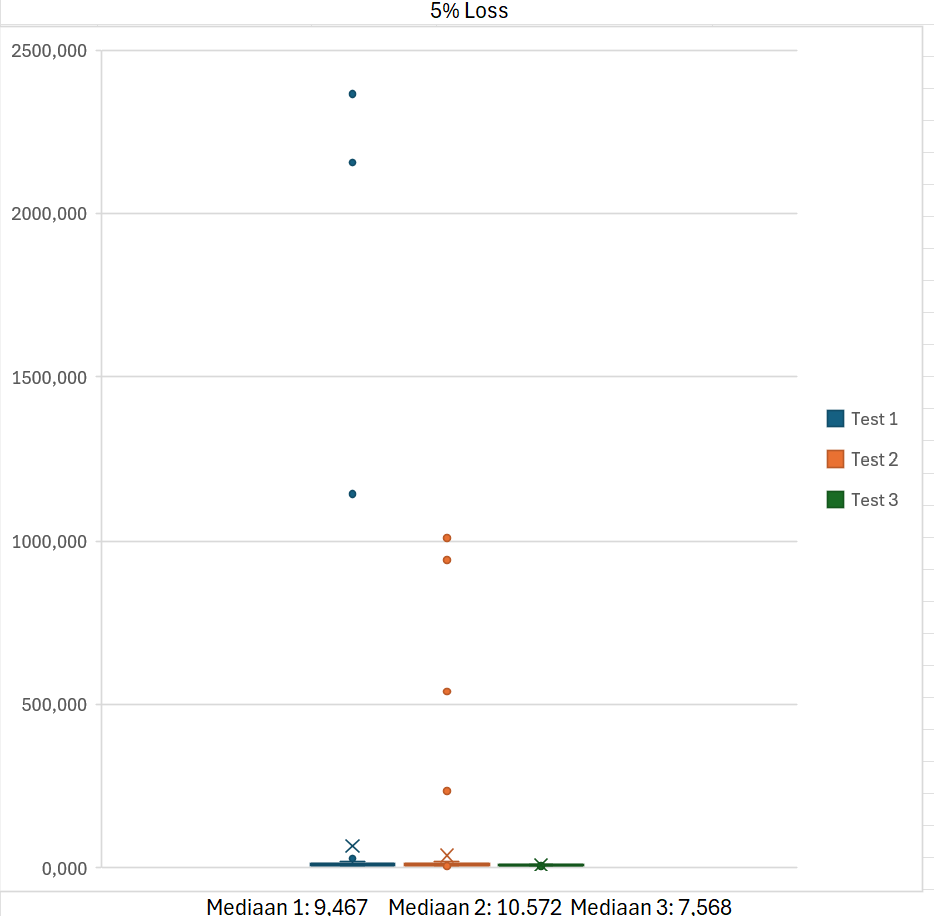

# Deelvraag 3: Hoe kan betrouwbare communicatie tussen de twee robotvloten(/ robots) worden bewaard bij vertragingen of tijdelijke netwerkuitval?

Uit de technische documentatie blijkt dat een betrouwbare communicatieoplossing uit meerdere onderdelen moet bestaan. Alleen een protocol gebruiken dat berichten kan herverzenden, is niet voldoende. Het systeem moet ook omgaan met oude berichten, dubbele opdrachten en een tijdelijk onbereikbare robotvloot.

### 3.4 Deelvraag 3: Welke invloed hebben netwerkvertraging en gesimuleerd pakketverlies op de prestaties en betrouwbaarheid van de TCP-communicatie tussen de twee robotvloten?

Om deze deelvraag te beantwoorden, is een softwareprototype ontwikkeld waarmee TCP-communicatie tussen een client en server kan worden getest. Met dit prototype wordt onderzocht hoe de communicatie reageert op verschillende netwerkcondities.  
Tijdens het onderzoek zijn verschillende situaties nagebootst, waaronder normale communicatie, toegevoegde netwerkvertraging en pakketverlies. De resultaten worden gebruikt om te bepalen welke invloed deze omstandigheden hebben op de rondreistijd (RTT) en het succespercentage van de communicatie.

#### 3.4.1 Onderzoeksopstelling en werkwijze

Voor het uitvoeren van de tests is een softwareprototype ontwikkeld in C++. Het prototype maakt gebruik van TCP-sockets om gegevens tussen een client en server uit te wisselen.  
Tijdens de communicatie wordt de RTT gemeten. Dit is de tijd tussen het versturen van een bericht en het ontvangen van het bijbehorende antwoord.  
Om de invloed van netwerkproblemen te onderzoeken, zijn verschillende netwerkcondities ingesteld. Hierbij is gebruikgemaakt van toegevoegde vertragingen en gesimuleerd pakketverlies.  
Iedere testconditie is drie keer uitgevoerd. Hierdoor kunnen de resultaten van verschillende uitvoeringen met elkaar worden vergeleken en wordt voorkomen dat de conclusie afhankelijk is van één enkele meting.  
De verzamelde meetgegevens zijn opgeslagen in een [spreadsheet](https://dev.azure.com/AvansHogeschoolAcademies/ATIx-2627-ESE2.1-OnderzoeksProject/_wiki/wikis/ATIx-2627-ESE2.1-OnderzoeksProject.wiki?wikiVersion=GBwikiMaster&pagePath=/Duo%252D3%252DTobias%26Sam/Onderzoek%201/%5Bstatistieken.xlsx%5D(https%3A//avans%20my.sharepoint.com/%3Ax%3A/g/personal/s_laurijssen2_student_avans_nl/IQARPnnsQr9BQ7Xket6rRxpYAQzO5nacXhXmG9ewMBpQoa8%3Fe%3Dw4IBSv)). Hierin zijn de gemiddelde RTT, minimale RTT, maximale RTT en het succespercentage bijgehouden.

#### 3.4.2 Uitgevoerde testscenario's

Voor het testen van de TCP-communicatie zijn de volgende testscenario's uitgevoerd:
| Testscenario | Beschrijving |
| --- | --- |
| Normaal | Communicatie zonder toegevoegde netwerkproblemen. |
| 100 ms vertraging | Er wordt 100 ms netwerkvertraging toegevoegd. |
| 300 ms vertraging | Er wordt 300 ms netwerkvertraging toegevoegd. |
| 5% pakketverlies | Er wordt 5% pakketverlies gesimuleerd. |
| 15% pakketverlies | Er wordt 15% pakketverlies gesimuleerd. |

_Alle bovenstaande scenario's zijn drie keer uitgevoerd. Per uitvoering zijn de meetresultaten vastgelegd._

#### 3.4.3 Meetresultaten

De resultaten laten verschillen zien tussen de verschillende testscenario's. Vooral de toegevoegde netwerkvertraging en het pakketverlies hebben invloed op de gemiddelde RTT.  
In tabel 1 staat een overzicht van de gemiddelde RTT, de minimale en maximale RTT van de eerste meetrun en het succespercentage per testconditie.
| Testconditie | Gem. RTT | minimum - maximum 1e | Succespercentage | Detectietijd uitval | Hersteltijd |
|---|---|---|---|---|---|
| Normaal | 7,732417 | 5.525 - 25.135 | 100% | n.v.t. | n.v.t. |
| 100 ms vertraging | 216,8702 | 201.473-245.707 | 100% | n.v.t. | n.v.t. |
| 300 ms vertraging | 620,4719 | 599.766-744.989 | 100% | n.v.t. | n.v.t. |
| 5% pakketverlies | 42,65289 | 5.633-2365.548 | 100% | n.v.t. | n.v.t. |
| 15% pakketverlies | 118,5368 | 5.313-3182.724 | 99% | n.v.t. | n.v.t. |

_Tabel 1: Overzicht van de gemeten TCP-communicatie per testconditie._  
De gemiddelde RTT is berekend aan de hand van de drie uitgevoerde meetruns. De afzonderlijke meetresultaten zijn opgenomen in de bijbehorende spreadsheet.  
  
_Grafiek 1: Overzicht van de RTT TCP-communicatie onder verschillende condities_  
De gemiddelde RTT is berekend aan de hand van de drie uitgevoerde meetruns.

#### 3.4.4 Analyse van de resultaten

Uit de resultaten blijkt dat de gemiddelde RTT bij normale communicatie 7,732 ms bedraagt. Dit vormt de uitgangssituatie waarmee de andere testscenario's worden vergeleken.  
Bij een toegevoegde vertraging van 100 ms stijgt de gemiddelde RTT naar 216,8702 ms. Bij 300 ms vertraging neemt deze verder toe tot 620,4718 ms. Dit laat zien dat de toegevoegde netwerkvertraging een duidelijke invloed heeft op de tijd die nodig is om een bericht uit te wisselen.  
Ook pakketverlies heeft invloed op de communicatie. Bij 5% pakketverlies bedraagt de gemiddelde RTT 42,65289 ms, helaas is deze gemiddlede waarde niet relevant, want er zitten grote uitschieters tot 3000+ms hierdoor wordt het gemiddelde buiten per portie vergroot en moeten we dus de mediaan pakken:
 

Het mediaan van de RTT is gemiddeld 9,205 dus je ziet dat 5% loss zorgt voor ~2ms extra delay gemiddeld met hele hoge pieken waarbij het uitschiet.

Wanneer het pakketverlies wordt verhoogd naar 15%, stijgt de gemiddelde RTT naar 118,5368 ms. Maar ook hier zijn er onregelmatig extreme pieken in de RTT, dus hier is ook de mediaan gepakt
Bij bijna uitgevoerde testscenario's is een succespercentage van 100% geregistreerd. Volgens de meetregistratie zijn bijna alle berichten dus succesvol uitgewisseld, ondanks de toegevoegde netwerkproblemen, alleen bij 15% loss is er 1 keer voorgekomen dat er een bericht niet aan is gekomen waardoor er een 99% succesvol meeting is gekomen.  
De hogere RTT bij pakketverlies kan erop wijzen dat TCP extra tijd nodig heeft om verloren gegevens opnieuw te verzenden. TCP beschikt namelijk over mechanismen om verloren gegevens te herstellen. Hierdoor kan de applicatie uiteindelijk wel een volledig bericht ontvangen, terwijl de onderliggende communicatie vertraging heeft opgelopen.

#### 3.4.5 Antwoord op deelvraag 3

Uit de uitgevoerde tests blijkt dat netwerkvertraging en pakketverlies invloed hebben op de prestaties van de TCP-communicatie.  
Bij toegevoegde vertraging stijgt de gemiddelde RTT duidelijk. Ook bij een hoger percentage pakketverlies neemt de gemiddelde RTT toe. Ondanks deze netwerkproblemen is tijdens de uitgevoerde tests een succespercentage van 100% gemeten.  
Dit laat zien dat de TCP-communicatie binnen de gebruikte testopstelling berichten succesvol kan uitwisselen onder verschillende netwerkcondities. Wel neemt de benodigde tijd voor het uitwisselen van berichten toe wanneer de netwerkcondities slechter worden.  
De resultaten geven daarmee inzicht in de betrouwbaarheid en prestaties van TCP-communicatie. Over het detecteren en herstellen van een volledige netwerkonderbreking kunnen op basis van de huidige meetresultaten nog geen conclusies worden getrokken.