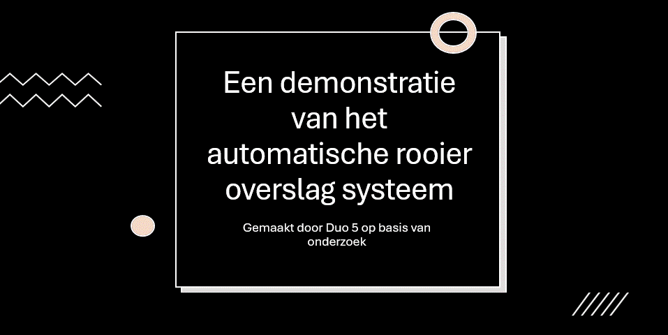

Deze wiki is opgesteld ter voorbereiding op het project "[ICT-B ESE2.1 Robot Fleet 2026-27 LU3](https://brightspace.avans.nl/d2l/le/lessons/308932/units/2082364)" en als ondersteuning bij de conclusie van het "[Onderzoeksproject infrastructuur](https://brightspace.avans.nl/d2l/le/lessons/308932/units/2074648)". Het doel van dit onderzoek is om onderbouwde keuzes met betrekking tot de communicatie-infrastructuur te maken en deze te verklaren en te verduidelijken voor het grotere project.

Ons project is gebaseerd op de casus "[Robotzwermen tegen bodemverdichting](https://brightspace.avans.nl/d2l/le/lessons/308932/topics/2204945)", uitgevoerd voor de opdrachtgever [NoTrack](https://notrack.nl/) en de product owner "[Robotisering en Sensoring](https://www.avans.nl/onderzoek/veiligheid-en-veerkracht/robotisering-en-sensoring)".

We moeten een proof of concept (schaalmodel op schaal 1:15) maken van een robotvloot bestaande uit een rooier en twee overslagwagens. Deze werken samen om gewassen van het veld af te voeren. Het systeem moet ervoor zorgen dat de rooier kan blijven rijden en dat de overslagwagens zo min mogelijk over dezelfde stukken grond rijden.  

Om het project goed te starten, oriënteren we ons eerst op de opdracht en brengen we de projectvereisten in kaart. We stellen de eisen vast om duidelijk te krijgen wat de proof of concept moet kunnen bereiken. Hoewel niet alle eisen direct betrekking hebben op communicatie, kunnen ze wel invloed hebben op de keuze voor een geschikte communicatieoplossing.

Vervolgens bepalen we welke keuzes er op het gebied van communicatie gemaakt moeten worden en op basis van welke eigenschappen deze keuzes worden beoordeeld. Daarna vergelijken we deze eigenschappen met de eisen van het project om vast te stellen welke oplossingen geschikt zijn.