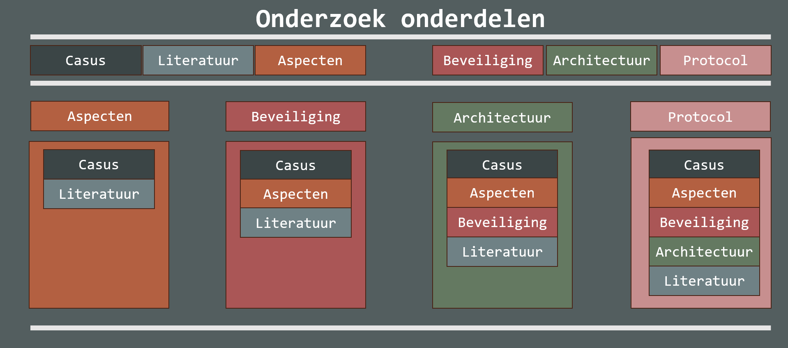

Er moeten meerdere keuzes worden gemaakt met betrekking tot de architectuur van het communicatiesysteem. Hiervoor onderzoeken we eerst welke eisen de communicatie tussen de computersystemen waarschijnlijk stelt. Hierbij kijken we naar aspecten zoals afstand, actieve tijd van het systeem, latency, communicatiefrequentie, hoeveelheid data en bandbreedte.

Vervolgens onderzoeken we de beveiliging. Hierbij bepalen we wat onze prioriteiten zijn en hoe we ervoor kunnen zorgen dat het communicatiesysteem aan deze beveiligingseisen voldoet.

Daarna richten we ons op de architectuur. Hierbij onderzoeken we de netwerkarchitectuur en de netwerktechnologieën die geschikt zijn voor het project.
Tot slot bekijken we de communicatieprotocollen. Hierbij onderzoeken we hoe berichten worden opgebouwd, welk berichtenformaat nodig is en welk protocol geschikt is voor het versturen van deze berichten.

Dit onderzoek is gebaseerd op de casus, literatuuronderzoek en eigen meningen, inschattingen en aannames. De verschillende onderzoek onderdelen bouwen op elkaar voort en hangen op de volgende manier met elkaar samen:
