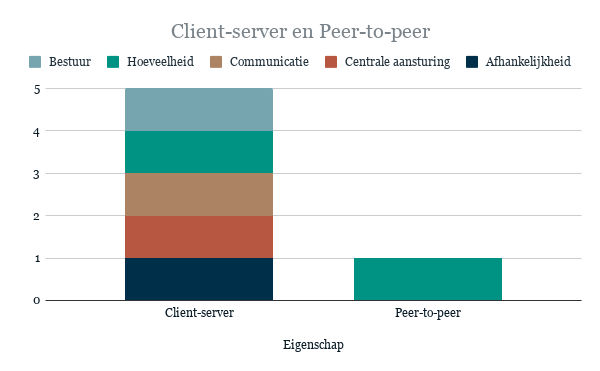
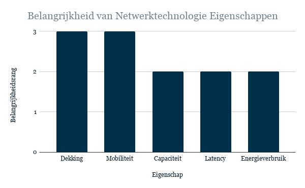
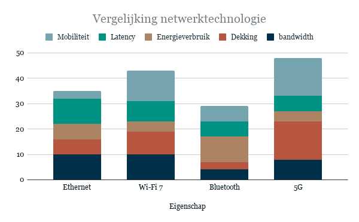

# Welke netwerkarchitectuur moet worden gebruikt?
Voor deze samenwerking is een geschikte netwerkarchitectuur nodig. Deze moet ervoor zorgen dat de communicatie tussen de rooier en de twee overslagwagens op een passende manier wordt georganiseerd.
Het doel van dit onderdeel is om te bepalen welke netwerkarchitectuur het beste aansluit bij de eisen van het project.

## Mogelijke oplossingen

Voor deze keuze onderzoeken we de volgende opties:
*   Client-server
*   Peer-to-peer

## Eigenschappen

| Eigenschap | Client-server | Peer-to-peer |
| --- | --- | --- |
| Centrale aansturing | Centrale aansturing via de server | Geen centrale aansturing vereist |
| Afhankelijkheid | Afhankelijk van een centraal punt | Afhankelijk van de afzonderlijke peers en hun verbindingen |
| Communicatie | Berichten lopen doorgaans via de server | Apparaten communiceren rechtstreeks met elkaar |
| Uitbreidbaarheid | Afhankelijk van de capaciteit en inrichting van de server | Afhankelijk van het aantal verbindingen en de gekozen implementatie |
| Schaalbaarheid | Afhankelijk van de capaciteit en inrichting van de server | Afhankelijk van het aantal peers en de gekozen implementatie |
| Hoeveelheid | Maakt niet uit | Onder 10 |
| Onderhoud, beveiliging, diensten en data bestuur | Gecentraliseerd en daardoor eenvoudiger te beheren | Meer verspreid en daardoor mogelijk complexer te beheren |

## Belangen van het project

[Open the interactive diagram](https://docs.google.com/spreadsheets/d/e/2PACX-1vT4-0vz09ZG511lJXogMtvccnye6YIjsOOZHBhUoZYLWox5UMDsEcLfjGB4AytakWguX7Yu4fTA9wcn/pubchart?oid=463868953&format=interactive)

**Centrale aansturing:** Volgens het casusproject moet het systeem een centrale controller hebben. Dit sluit aan bij centrale aansturing. **Dus: client-server.**  
**Afhankelijkheid:** Het is natuurlijk beter als de overige systemen blijven functioneren wanneer één systeem uitvalt. Aangezien in dit project alle systemen moeten samenwerken, zijn ze echter onderling afhankelijk. Daarom past een client-serverstructuur beter bij het proces. **Dus: client-server.**  
**Communicatie:** Volgens het casusproject moet het systeem een centrale controller hebben. Dit sluit aan bij een client-serverstructuur. **Dus: client-server.**  
**Hoeveelheid:** Afhankelijk van de vraag of de server apart staat of in een van de machines is geïntegreerd, zijn er vijf tot zes machines die deel uitmaken van het netwerk. Beide architecturen kunnen dit aantal prima aan. **Dus: beide zijn geschikt.**  
**Onderhoud, beveiliging, diensten en gegevensbeheer:** Het is handiger als één centraal punt alle informatie beheert, onderhoudt en beveiligt. Het afzonderlijk controleren van elk systeem zou meer moeite kosten. **Dus: client-server.**

## Conclusie

Op basis van het literatuuronderzoek lijkt een **client-serverarchitectuur** de meest logische keuze voor dit project. Er zijn echter nog enkele zaken die nader moeten worden onderzocht. Zo is nog niet vastgesteld of de server een afzonderlijk apparaat wordt of onderdeel uitmaakt van een van de andere systemen. Ook zijn de specifieke eisen en eigenschappen van de server nog niet bekend.

_Voor dit onderzoek is gebruikgemaakt van de bronnen [1], [2], [3] en [4]._

 

# Welke netwerktechnologie moet worden gebruikt?

Voor deze samenwerking is een geschikte netwerktechnologie nodig. Deze moet ervoor zorgen dat de apparaten onderling gegevens kunnen uitwisselen.
Het doel van dit onderdeel is om te bepalen welke oplossing het beste aansluit bij de eisen van het project.

## Mogelijke oplossingen

Voor deze keuze onderzoeken we de volgende opties:
*   Ethernetbekabeling
*   Wi-Fi 7
*   Bluetooth
*   Mobiel netwerk (5G)

## Eigenschappen

| Eigenschap | Ethernet | Wi-Fi 7 | Bluetooth | 5G |
| --- | --- | --- | --- | --- |
| Dekking | Lokaal netwerk, eventueel gekoppeld aan een groter netwerk | Lokaal | Kort bereik | Groot bereik, afhankelijk van de netwerkdekking |
| Mobiliteit | Beperkt door de kabel | Mobiliteit binnen het bereik van het netwerk | Beperkt bereik | Hoge mobiliteit binnen het bereik van het netwerk |
| bandwidth | Hoog | Hoog tot zeer hoog | Laag tot gemiddeld, afhankelijk van de versie | Gemiddeld tot hoog, afhankelijk van het netwerk |
| Latency | Laag en stabiel | Laag, maar wisselend | Afhankelijk van de toepassing | Afhankelijk van de netwerkomstandigheden |
| Energieverbruik | Afhankelijk van de apparatuur | Gemiddeld tot hoog | Over het algemeen laag | Gemiddeld tot hoog |

## Belangen van het project

**Dekking (rang 3):** krijgt een hoge prioriteit, omdat de casus zich afspeelt op een groot perceel. Het netwerk moet daarom een groot gebied kunnen bestrijken. Dit maakt dekking een hoofddoel van het product.  
**Mobiliteit (rang 3):** krijgt een hoge prioriteit, omdat de casus meerdere bewegende machines omvat. Het netwerk moet communicatie mogelijk maken terwijl de machines zich over het perceel verplaatsen. Dit maakt mobiliteit een hoofddoel van het product.  
**Capaciteit (rang 2):** krijgt een gemiddelde prioriteit, omdat het netwerk voldoende gegevens moet kunnen verwerken en versturen om de communicatie tussen de machines te ondersteunen. De benodigde capaciteit hangt af van de hoeveelheid gegevens en de frequentie waarmee berichten worden verstuurd.  
**Latency (rang 2):** krijgt een gemiddelde prioriteit, omdat berichten op tijd moeten aankomen om de communicatie en besturing van de machines te ondersteunen. Hoewel een lage latency belangrijk is, moet de vereiste maximale vertraging nog worden vastgesteld.  
**Energieverbruik (rang 2):** krijgt een gemiddelde prioriteit, omdat het netwerk niet onnodig veel energie moet verbruiken. De machines moeten tijdens het werk voldoende energie beschikbaar houden. Energieverbruik is echter minder bepalend dan dekking en mobiliteit, omdat deze eigenschappen direct invloed hebben op de communicatie over het perceel.

## Conclusie

  
[Open the interactive diagram](https://docs.google.com/spreadsheets/d/e/2PACX-1vT4-0vz09ZG511lJXogMtvccnye6YIjsOOZHBhUoZYLWox5UMDsEcLfjGB4AytakWguX7Yu4fTA9wcn/pubchart?oid=117663212&format=interactive)
Op basis van de gewogen scoreberekening behaalt 5G de hoogste totaalscore, met 48 punten. Volgens de gehanteerde beoordelingsmethode is **5G daarmee de voorkeursoptie voor dit project**.

_Voor dit onderzoek is gebruikgemaakt van bron [5]._

 

* * *

# Bronnen

[1] GeeksforGeeks, “Classification of Computer Network on basis of Architecture,” _GeeksforGeeks_, Sep. 22, 2025. [https://www.geeksforgeeks.org/computer-networks/classification-of-computer-network-on-basis-of-architecture/](https://www.geeksforgeeks.org/computer-networks/classification-of-computer-network-on-basis-of-architecture/)  
[2] GeeksforGeeks, “Difference between ClientServer and PeertoPeer Network,” _GeeksforGeeks_, Jul. 11, 2025. [https://www.geeksforgeeks.org/computer-networks/difference-between-client-server-and-peer-to-peer-network/](https://www.geeksforgeeks.org/computer-networks/difference-between-client-server-and-peer-to-peer-network/)  
[3] G. Sah, “Understanding Client–Server vs. Peer-to-Peer networks”, _Medium_, 10 april 2025. [https://gauravssah.medium.com/understanding-client-server-vs-peer-to-peer-networks-57618dffb384](https://gauravssah.medium.com/understanding-client-server-vs-peer-to-peer-networks-57618dffb384)  
[4] “View of Comparative Analysis of Network architecture: Client-Server versus Peer-to-Peer.” [https://journal.uwais.ac.id/index.php/witech/article/view/38/28](https://journal.uwais.ac.id/index.php/witech/article/view/38/28)  
[5] N. Naineni, “Network Technologies for Heterogeneous and Converged Connectivity: A Comparative survey”, _Engineer Engrxiv Archive_, sep. 2026, doi: 10.31224/8154.

