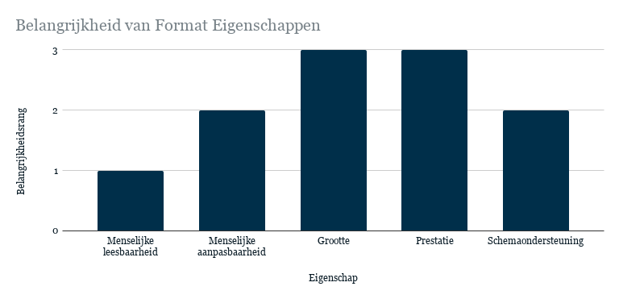
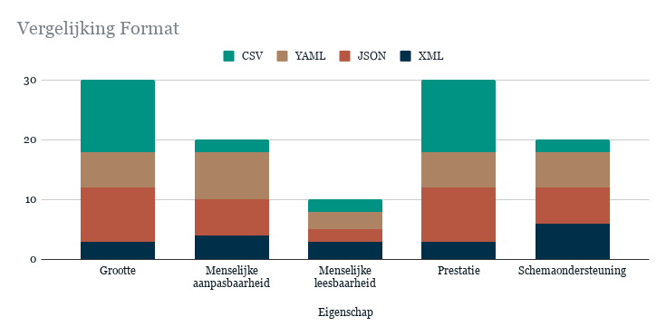
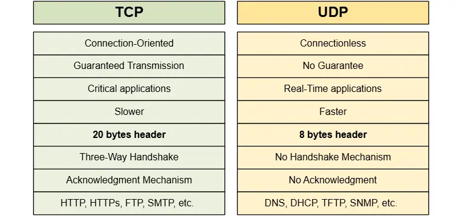

# Wat moet er worden verstuurd?

Voor deze samenwerking moet duidelijk zijn welke gegevens de systemen onderling uitwisselen. Dit onderdeel beschrijft de inhoud van de berichten die nodig zijn voor de communicatie tussen de robots, de centrale controller en de operatorinterfaces.
Het doel van dit onderdeel is om te bepalen welke gegevens moeten worden verstuurd om aan de eisen van het project te voldoen.

## Communicatielijnen

### Cyclusberichtlijn

Deze berichtlijn beschrijft de cyclus van het ophalen en afladen van gewassen door de rooier en de overslagwagens.

| Bericht | Verstuurder | Ontvanger | Benodigde gegevens |
| --- | --- | --- | --- |
| Overslagwagen oproepen | Rooier | Overslagwagen | ID, taakstatus rooier |
| Rooier aanroepen | Overslagwagen | Rooier | ID, taakstatus overslagwagen |
| Rooier afmelden | Overslagwagen | Rooier | ID, taakstatus overslagwagen |
| Overslagwagen afmelden | Rooier | Overslagwagen | ID, taakstatus rooier |
| Lospunt bereikt melden | Overslagwagen | Centrale controller | ID, taakstatus overslagwagen |

*Verstuurder = het systeem dat het bericht verstuurt.  
*Ontvanger = het systeem dat het bericht ontvangt.
Het vullingspercentage is niet opgenomen, omdat de logica voor het bepalen van de benodigde acties intern wordt afgehandeld.

### Besturingsberichtlijn

Deze berichtlijn beschrijft de communicatie voor het versnellen, vertragen en besturen van de overslagwagens.
| Bericht | Verstuurder | Ontvanger | Benodigde gegevens |
| --- | --- | --- | --- |
| Snelheid wijzigen | Rooieroperatorinterface | Overslagwagen | ID, lineaire snelheid |
| Snelheid wijzigen | Randoperatorinterface | Overslagwagen | ID, lineaire snelheid, angulaire snelheid |
| Besturing wijzigen | Operatorinterface | Overslagwagen | ID, besturingsstatus |

*Verstuurder = het systeem dat het bericht verstuurt.  
*Ontvanger = het systeem dat het bericht ontvangt.

### Interfaceberichtlijn

Deze berichtlijn beschrijft de communicatie waarmee de operatorinterface informatie over de voertuigen ontvangt.
De casus vereist dat de status van de robots inzichtelijk is, maar specificeert niet welke informatie precies moet worden weergegeven. Daarom zijn op basis van de beschikbare informatie enkele aannames gedaan over de benodigde berichten.
| Bericht | Verstuurder | Ontvanger | Benodigde gegevens |
| --- | --- | --- | --- |
| Machinestatus melden | Rooier | Operatorinterface | ID, taak, besturingsstatus, lineaire snelheid, angulaire snelheid, locatie |
| Machinestatus melden | Overslagwagen | Operatorinterface | ID, taak, besturingsstatus, lineaire snelheid, angulaire snelheid, locatie |
| Waarschuwing melden | Robot | Operatorinterface | ID, waarschuwing, ernst |

*Verstuurder = het systeem dat het bericht verstuurt.  
*Ontvanger = het systeem dat het bericht ontvangt.
Daarnaast zijn er enkele mogelijke berichten die de functionaliteit van de operatorinterface kunnen uitbreiden.

| Bericht | Verstuurder | Ontvanger | Benodigde gegevens |
| --- | --- | --- | --- |
| Perceelstatus melden | Centrale controller | Operatorinterface | Voltooiingsstatus |
| Communicatiestatus melden | Robot | Operatorinterface | ID, verbindingsstatus, tijdstip van laatste update |
| Taakstatus melden | Robot | Operatorinterface | ID, huidige status, taakvoortgang |

*Verstuurder = het systeem dat het bericht verstuurt.  
*Ontvanger = het systeem dat het bericht ontvangt.

## Conclusie

Op basis van de casus zijn twee mogelijke voorstellen opgesteld voor de gegevensstructuur. Deze voorstellen beschrijven welke variabelen nodig kunnen zijn om de berichten tussen de systemen uit te wisselen.

### Voorstel 1: Gecombineerde gegevensstructuur

| Variabele | Datatype | Eenheid of structuur |
| --- | --- | --- |
| Rooier-ID | GUID | - |
| Overslagwagen-ID | GUID | - |
| Taak | ENUM | - |
| Besturingsstatus | BOOL | - |
| Lineaire snelheid | FLOAT | Meter per seconde (m/s) |
| Angulaire snelheid | FLOAT | Radiaal per seconde (rad/s) |
| Locatie | STRUCT | X-positie (FLOAT), Y-positie (FLOAT), oriëntatie (FLOAT) |
| Waarschuwing | ENUM | - |
| Ernst | ENUM | - |

### Voorstel 2: Gescheiden gegevensstructuren per berichttype

In dit voorstel krijgt elk berichttype een eigen gegevensstructuur. Hierdoor bevat elk bericht alleen de gegevens die nodig zijn voor de betreffende functie. Dit voorkomt dat bij ieder bericht onnodige gegevens worden meegestuurd en maakt de berichtstructuren specifieker.

 

**Structuur A: Taakbericht**
| Variabele | Datatype | Eenheid of structuur |
| --- | --- | --- |
| Rooier-ID | GUID | - |
| Overslagwagen-ID | GUID | - |
| Taak | ENUM | - |

 

**Structuur B: Besturingsbericht**
| Variabele | Datatype | Eenheid of structuur |
| --- | --- | --- |
| Overslagwagen-ID | GUID | - |
| Lineaire snelheid | FLOAT | Meter per seconde (m/s) |
| Angulaire snelheid | FLOAT | Radialen per seconde (rad/s) |
| Besturingsstatus | BOOL | - |

 

**Structuur C: Locatie bericht**
| Variabele | Datatype | Eenheid of structuur |
| --- | --- | --- |
| Overslagwagen-ID | GUID | - |
| Locatie | STRUCT | X-positie (FLOAT), Y-positie (FLOAT), oriëntatie (FLOAT) |

 

**Structuur D: Waarschuwingsbericht**
| Variabele | Datatype | Eenheid of structuur |
| --- | --- | --- |
| Robot-ID | GUID | - |
| Waarschuwing | ENUM | - |
| Ernst | ENUM | - |

 

**Structuur E: Statusbericht**
| Variabele | Datatype | Eenheid of structuur |
| --- | --- | --- |
| Robot-ID | GUID | - |
| Taak | ENUM | - |
| Besturingsstatus | BOOL | - |
| Lineaire snelheid | FLOAT | Meter per seconde (m/s) |
| Angulaire snelheid | FLOAT | Radialen per seconde (rad/s) |
| Locatie | STRUCT | X-positie (FLOAT), Y-positie (FLOAT), oriëntatie (FLOAT) |

 

**Structuur F: Communicatiestatusbericht**
| Variabele | Datatype | Eenheid of structuur |
| --- | --- | --- |
| Robot-ID | GUID | - |
| Verbindingsstatus | ENUM | - |
| Tijdstip van laatste update | TIMESTAMP | - |

 

**Structuur G: Perceelstatusbericht**
| Variabele | Datatype | Eenheid of structuur |
| --- | --- | --- |
| Voltooiingsstatus | FLOAT | Percentage (%) |

 

**Structuur H: Taakvoortgangsbericht**
| Variabele | Datatype | Eenheid of structuur |
| --- | --- | --- |
| Robot-ID | GUID | - |
| Huidige status | ENUM | - |
| Taakvoortgang | FLOAT | Percentage (%) |

 

# Welk format wordt gebruikt voor de berichten?
Voor deze samenwerking is een berichtenformat nodig. Dit format zorgt ervoor dat gegevens op een gestructureerde en eenduidige manier worden vastgelegd, zodat de verzendende en ontvangende systemen deze correct kunnen verwerken.

Het doel van dit onderdeel is om te bepalen welk berichtenformat het beste aansluit bij de eisen van het project.

## Mogelijke opties

Voor deze keuze worden de volgende opties onderzocht:
*   XML
*   JSON
*   YAML
*   CSV

Deze opties zijn geselecteerd omdat ze bekende formaten zijn voor het opslaan en uitwisselen van gegevens.

## Eigenschappen

| Eigenschap | XML | JSON | YAML | CSV |
| --- | --- | --- | --- | --- |
| Menselijke leesbaarheid | Hoog | Gemiddeld | Hoog | Gemiddeld |
| Menselijke aanpasbaarheid | Laag | Gemiddeld | Hoog | Wisselend |
| Grootterangschikking* | Plaats 4 | Plaats 2 | Plaats 3 | Plaats 1 |
| Prestatierangschikking* | Plaats 4 | Plaats 2 | Plaats 3 | Plaats 1 |
| Schemaondersteuning | Goed | Goed | Goed | Beperkt |

* Bij de rangschikking op basis van bestandsgrootte staat het kleinste formaat op de eerste plaats.  
* Bij de rangschikking op basis van prestaties staat het snelste formaat op de eerste plaats.
De informatie is gebaseerd op een bron waarin een hypothetische standaardcomputingomgeving wordt gebruikt. De bron vermeldt:

> "These results are purely hypothetical and are intended for illustrative purposes only. Actual performance can vary significantly depending on the specific data structure, the size of the data, the implementation of the serialization library, the programming language, and the underlying hardware" [1].

De resultaten zijn dus uitsluitend bedoeld ter illustratie. De daadwerkelijke prestaties kunnen verschillen afhankelijk van de gegevensstructuur, de hoeveelheid data, de gebruikte serialisatiebibliotheek, de programmeertaal en de hardware.

## Belangen van het project

[Open the interactive diagram](https://docs.google.com/spreadsheets/d/e/2PACX-1vT4-0vz09ZG511lJXogMtvccnye6YIjsOOZHBhUoZYLWox5UMDsEcLfjGB4AytakWguX7Yu4fTA9wcn/pubchart?oid=62481907&format=interactive)

**Menselijke leesbaarheid (rang 1)** krijgt de laagste prioriteit, omdat de communicatie voornamelijk door machines wordt verwerkt en de berichten niet bedoeld zijn om rechtstreeks door mensen te worden gelezen.  
**Menselijke aanpasbaarheid (rang 2)** krijgt een gemiddelde prioriteit. Het is belangrijk dat de gegevensstructuur eenvoudig kan worden aangepast en dat de bijbehorende code goed onderhoudbaar blijft. Dit is echter niet het hoofddoel van het product.  
**Schemaondersteuning (rang 2)** krijgt een gemiddelde prioriteit. Schema's helpen bij het vastleggen van de berichtstructuur en het valideren van gegevens. Dit kan fouten tijdens het ontwikkelen en debuggen helpen voorkomen. Dit is echter niet het hoofddoel van het product.  
**Grootte (rang 3)** krijgt een hoge prioriteit, omdat de hoeveelheid data die wordt verstuurd invloed kan hebben op het netwerkverkeer, het geheugengebruik en de efficiëntie van het product.  
**Prestatie (rang 3)** krijgt een hoge prioriteit, omdat de snelheid waarmee berichten worden verwerkt invloed kan hebben op de reactietijd en de werking van het systeem.

## Conclusie

Om te bepalen welk format het beste aansluit bij de projectcriteria, wordt een gewogen score berekend. Hierbij wordt de score per eigenschap vermenigvuldigd met de belangrijkheidsrang van die eigenschap.
De formule is:

$$\text{Gewogen score} = \text{Puntenscore} \times \text{Belangrijkheidsrang}$$

De gewogen scores per eigenschap worden vervolgens bij elkaar opgeteld. Het format met de hoogste totaalscore komt volgens deze beoordelingsmethode het beste overeen met de gekozen criteria.

*CSV krijgt voor menselijke aanpasbaarheid een score van 1, omdat het (wanneer in de vorm van een text editor) geen echte ondersteuning heeft.  

[Open the interactive diagram](https://docs.google.com/spreadsheets/d/e/2PACX-1vT4-0vz09ZG511lJXogMtvccnye6YIjsOOZHBhUoZYLWox5UMDsEcLfjGB4AytakWguX7Yu4fTA9wcn/pubchart?oid=701980066&format=interactive)

Op basis van de gewogen scoreberekening behaalt JSON de hoogste totaalscore, met 32 punten. Volgens de gehanteerde beoordelingsmethode is **JSON daarmee de voorkeursoptie voor dit project**.

 

_Voor dit onderzoek is gebruikgemaakt van bron [1]._

# Welk transportprotocol moet worden gebruikt?

Voor deze samenwerking is een transportprotocol nodig. Dit protocol bepaalt hoe berichten tussen de systemen worden verzonden en welke eigenschappen de gegevensoverdracht heeft.
Het doel van dit onderzoek is om te bepalen welk transportprotocol het beste aansluit bij de eisen van het project.

## Mogelijke opties

Voor deze keuze worden de volgende opties onderzocht:
*   UDP
*   TCP

## Eigenschappen
 
\* Dit voorbeeld is afkomstig van Ivanov en Ivanov (z.d., figuur 8, ‘TCP vs. UDP’). Hoewel de meeste punten in de figuur correct zijn, zijn er twee aanvullingen nodig. Ten eerste varieert de lengte van de TCP-header van 20 tot 60 bytes, zoals bevestigd door twee andere bronnen[3][5]. Ten tweede hangt de snelheid van TCP en UDP af van de omstandigheden en de kenmerken van de toepassing. Hoewel UDP in bepaalde situaties sneller kan zijn doordat het minder protocoloverhead heeft en, in tegenstelling tot TCP, geen bevestiging (ACK) van de ontvanger vereist voor elk verzonden pakket, is UDP niet onder alle omstandigheden sneller dan TCP.

## Belangen van het project

| Eigenschap | Consequentie | Schade | Gevolg |
| --- | --- | --- | --- |
| Onbetrouwbare gegevensoverdracht      UDP | Een bericht kan verloren gaan zonder dat het programma dit opmerkt | Een overslagwagen weet niet dat de rooier vol is en komt niet aan | Groot |
| Grotere header bij      TCP | Berichten bevatten meer protocolinformatie | Er wordt meer data verzonden, wat extra netwerkbelasting veroorzaakt | Klein |

## Conclusie
Op basis van de belangen van het project is TCP het meest geschikte transportprotocol. Betrouwbare gegevensoverdracht is belangrijk voor de samenwerking tussen de rooier en de overslagwagen. Wanneer een besturingsbericht verloren gaat, kan dit leiden tot vertragingen, verstoringen of onveilige situaties.
Hoewel TCP meer protocoloverhead veroorzaakt door de grotere header, is de extra netwerkbelasting bij de relatief kleine besturingsberichten beperkt. De voordelen van betrouwbare gegevensoverdracht wegen daarom zwaarder dan de nadelen van de extra overhead.

_Voor dit onderzoek is gebruikgemaakt van de bronnen [2], [3] en [4]._

 

* * *

# Bronnen
[1] W. Wang, N. Li, L. Zhang, F. Liu, H. Chen, X. Yang, L. Huang, M. Zhao, G. Wu, J. Zhou, J. Xu, T. Sun, L. Ma, Q. Zhu, J. Hu, W. Guo, Y. He, Y. Gao, D. Lin, Y. Zheng, and L. Shi, “An extensive study on text serialization formats and methods,” _arXiv (Cornell University)_, May 2025, doi: 10.48550/arxiv.2505.13478.  
[2] “IP Stack - ICT-B ESE2.1 Robot Fleet 2026-27 P1-P2 Breda.” [https://brightspace.avans.nl/d2l/le/lessons/308932/topics/2074676](https://brightspace.avans.nl/d2l/le/lessons/308932/topics/2074676)  
[3] GeeksforGeeks, “TCP vs. UDP,” _GeeksforGeeks_, Mar. 28, 2026. [https://www.geeksforgeeks.org/computer-networks/differences-between-tcp-and-udp/](https://www.geeksforgeeks.org/computer-networks/differences-between-tcp-and-udp/)  
[4] I. Ivanov and I. Ivanov, “TCP and UDP essentials,” _NetworkAcademy.IO_. [https://www.networkacademy.io/ccna/network-security/tcp-and-udp-essentials](https://www.networkacademy.io/ccna/network-security/tcp-and-udp-essentials)  
[5] Josh and Josh, “TCP vs UDP: Header Size, Packet Size, and Differences,” _Digilent Blog_, Dec. 28, 2024. [https://digilent.com/blog/udp-vs-tcp/?srsltid=AYCX9vLJcLpOp7jxjgT7BCztAnE3uTWYkETFjQTNUACWdTd99XQXA3Zf](https://digilent.com/blog/udp-vs-tcp/?srsltid=AYCX9vLJcLpOp7jxjgT7BCztAnE3uTWYkETFjQTNUACWdTd99XQXA3Zf)  
[6] F. Hmissi and S. Ouni, “A survey on application layer protocols for IoT networks,” _ResearchGate_, Apr. 2022, [Online]. Available: [https://www.researchgate.net/publication/363257826_A_Survey_on_Application_Layer_Protocols_for_IoT_Networks](https://www.researchgate.net/publication/363257826_A_Survey_on_Application_Layer_Protocols_for_IoT_Networks)  
[7] GeeksforGeeks, “Protocols in application layer,” _GeeksforGeeks_, Oct. 03, 2025. [https://www.geeksforgeeks.org/computer-networks/protocols-application-layer/](https://www.geeksforgeeks.org/computer-networks/protocols-application-layer/)

