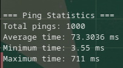
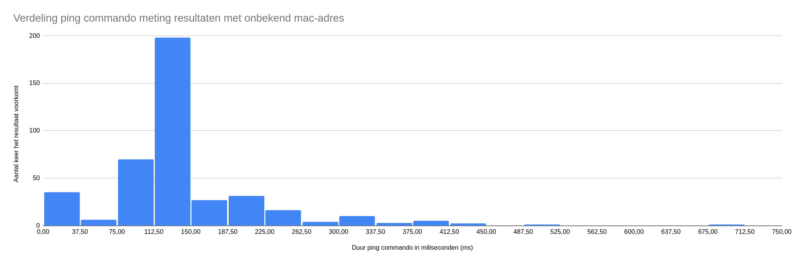

##1. DEELVRAAG 1: Hoe werkt ARP bij het verzenden van data?
---------------------------------------------------------

### 1.1 Literatuuronderzoek

Als een computer iets wil versturen naar een bepaald IP-adres, dan wordt eerst de ARP-cache van de computer gecheckt om te kijken of het MAC-adres bekend is van de ontvanger. Is dat niet het geval, dan wordt er een ARP-aanvraag naar de router gestuurd en deze gebruikt ARP om het MAC-adres te vinden.
ARP zal eerst in de ARP-cache van de router kijken. Als het niet in de cache staat, dan zal de router een verzoek naar het ontvangen IP-adres sturen. Het ontvangen IP-adres stuurt zijn MAC-adres terug naar de router en de cache wordt bijgewerkt. De router stuurt dan weer het MAC-adres door naar de verzendende computer.
Dan zal uiteindelijk het bericht dat verzonden wil worden, verstuurd worden naar het ontvangelde IP-adres. Zou het MAC-adres al wel in de cache zitten van de verzendende computer, dan kan het bericht gelijk verzonden worden naar het bestemde IP-adres.
**Bronnen:**  
Bron 1: Duò, M. (2025, October 1). _Wat is ARP? Hoe het Address Resolution Protocol werkt_. Kinsta®. [https://kinsta.com/nl/blog/wat-is-arp/](https://kinsta.com/nl/blog/wat-is-arp/)
Bron 2: Redactie. (2020, March 23). _Welke factoren beïnvloeden de snelheid van uw netwerk? ICT-tips_. No Corners. [https://www.nocorners.nl/factoren-snelheid-netwerk/](https://www.nocorners.nl/factoren-snelheid-netwerk/)

## 2. DEELVRAAG 2: Wat is het tijdsverschil bij bekende en onbekende MAC-adressen?
-------------------------------------------------------------------------------

### 2.1 Prototyping Light

Om te testen wat het verschil in tijd is tussen de eerste communicatie waar het MAC-adres nog onbekend is en de verdere communicatie, hebben we een C++ programma geschreven. We hebben dit via onze Linux-omgeving gedaan uit het voorkeur dat we hierna sowieso veel op Linux gaan werken.
We hebben hierbij een programma geschreven wat een IP pingt binnen hetzelfde netwerk met een onbekend MAC-adres. Vervolgens wordt hier de tijd die het ping commando retourneert, en toegevoegd aan een vector waar alle resultaten van alle iteraties in opgeslagen worden. Dan verwijdert het programma de gegevens van het gepingde IP uit de ARP lijst voordat de volgende ping weer wordt uitgevoerd.
Vervolgens berekenen we hieruit het gemiddelde van alle pings en halen we ook de kortste en langste tijd uit. Tot slot voeren we hetzelfde aantal iteraties aan pings uit met een bekend MAC-adres en houden ook hierbij het gemiddelde, de kortste en de langste periode weer.

### 2.2 Data-analyse

Als laatste onderzoek zijn we de data uit het prototype gaan analyseren door behulp van het visualiseren van de data en het vergelijken van de gemiddeldes, kortste en langste waardes.

* * *

3. RESULTATEN
-------------

### 3.1 Deelvraag 1

Het resultaat van deze deelvraag is eigenlijk wat ook al bij de analyse staat (Onderzoeksanalyse vraag 5 deelvraag 1). Daar staat weergegeven wat de deelvraag vroeg over wat ARP precies doet als het MAC-adres onbekend is bij het verzenden van een data pakket.

### 3.2 Deelvraag 2

Bij deze deelvraag hebben we de volgende resultaten uit de prototype test.
Zoals hieronder in Figuur 1 te zien, hebben we over 1000 keer het ping commando uitgevoerd en een aantal resultaten zoals de gemiddelde tijd, de kortste tijd en de langste tijd die het commando nodig had:
  
**Figuur 1:** Resultaten van de gerunde prototype test zonder bekend MAC-adres.
Op zich zegt dat nog niet heel veel, maar door het in een histogram weer te geven zoals hier in Figuur 2, kunnen we de verdeling van de verschillende tijdswaarden visualiseren.
  
**Figuur 2:** Verdeling ping commando meting resultaten met onbekend mac-adres

* * *

4. Conclusie
------------

Dus hoeveel extra vertraging treedt op bij de eerste communicatie tussen de robots als het mac adres van de ontvanger nog niet bekend is. Als ARP nog niet het MAC-adres weet dan is de gemiddelde vertraging 73,3036 ms, als ARP wel het MAC-adres weet dan is de gemiddelde vertraging 10.72 ms. Dit is dus een verschil van 62.5836 ms. Bij de testen die we hadden gedaan was als het MAC-adres onbekend was, altijd trager dan als het MAC-adres wel bekend was. Dit is te zien in figuur 1 op de onderzoeksresultaat pagina, daar is te zien dat de meeste resultaten hoger ligt dan het gemiddelde als het MAC-adres wel bekend was.